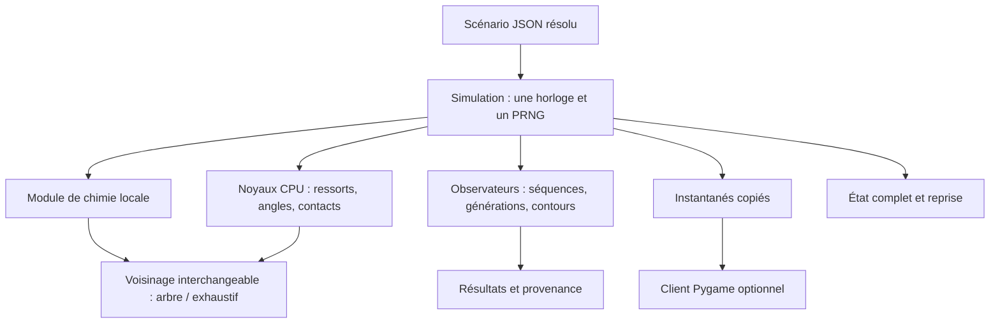

# Architecture du simulateur partagé

## Choix de ce lot

Python 3.12 organise l'expérience, NumPy contient l'état, Numba compile les noyaux
numériques CPU, SciPy cKDTree produit les contacts spatiaux. Pygame est un client
optionnel. Ce choix conserve les expériences existantes et permet de modifier
rapidement la chimie ; aucun compilateur C++ séparé n'est nécessaire au lancement.
Les idées du moteur historique — cœur indépendant, voisinage contrôlable,
sauvegarde du PRNG — sont reprises sans dépendre du dossier temporaire supprimé.



## Répartition du code

| Module | Responsabilité |
| --- | --- |
| `simulator/engine.py` | Préparation, cadence des réactions, intégration, arrêt au nombre de pas demandé |
| `spatial.py` | Contacts finis triés, arbre KD ou référence exhaustive, cache de voisinage avec marge |
| `physics.py` | Noyaux compilés de répulsion, ressorts, angles, orientation et attraction |
| `copy.py`, `membrane.py`, `catalysis.py` | Conditions initiales et lois locales propres aux trois chimies ; le prototype C1 reste distinct des F composites |
| `docking.py` | Géométrie de faces, potentiel coopératif à quatre billes et capture pour V8 |
| `substrates.py` | Capture et ligation locales de X/Y sur les vrais F du hook `copy`, occupations exclusives et activation par voisin de squelette |
| `registry.py` | Association explicite d'un nom de modèle, d'un hook, de paramètres et d'un observateur |
| `observations.py` | Analyse uniquement : chaînes complètes, filiation, géométrie, boucles |
| `runner.py`, `cli.py` | Campagnes, sorties, critères observés et ligne de commande |
| `checkpoint.py` | État NPZ/JSON versionné, empreintes du code et PRNG exact |
| `viewer.py` | Travailleur propriétaire du moteur, commandes et affichage d'instantanés |
| `reference.py` | Formules de référence et géométrie locale ; aucun second ordonnanceur |

Les anciens `experiments/local_dynamics.py` et `run_local_research.py` délèguent
désormais à ce moteur. Les vieux dossiers d'essais conservent leur propre code,
avec ses résultats et son rejeu : leur contenu n'est pas remplacé par la migration.

## Format des scénarios

```json
{
  "schema_version": 1,
  "name": "Mon essai",
  "model": "copy",
  "seed": 0,
  "duration": 600,
  "engine": {"dt": 0.005, "spatial": "tree", "skin": 0.25, "sample_every": 100},
  "chemistry": {"sequence": "001011", "free_units": 48, "monomer_only_capture": true},
  "expected": {"detached_copy_sets_ever": {"min": 1}}
}
```

`config.resolve` complète les valeurs par défaut et rejette les clés inconnues,
les pas invalides et plusieurs géométries invalides. Le fichier sauvegardé contient
les valeurs résolues ; les démonstrateurs les donnent aussi explicitement.
Les critères `min`, `max`, `eq` portent sur des métriques, après la dynamique.
Les unités sont celles, sans calibration physique, des prototypes de recherche.

La durée doit être un multiple entier de `dt`. La chimie est mise à jour tous
les cinq pas ; modifier `dt` change aussi cet intervalle. Le mode actuel est 2D,
sans frontières périodiques, dans l'espace ouvert ou avec des murs souples.

## Contrat d'un module chimique

Un hook construit depuis `(config, rng)` expose :

- `pos` : tableau flottant contigu de positions ; `kinds` : types entiers ;
  `contact` : petite matrice de distances d'exclusion, zéro autorisant le recouvrement.
- `springs` et `angles` : tableaux de liens/angles avec leurs paramètres locaux.
  Ces liens restent calculés même si leurs partenaires sont loin.
- `box`, `mobility` et la température dans sa configuration.
- `react(time, dt, neighbors)` : motifs locaux, mutations des liens/états,
  reconstruction des tableaux mécaniques et liste des événements d'analyse.
- `extra_forces(neighbors)` : forces supplémentaires purement locales.
- `observe(callback, time, events)` : transmission aux observateurs ; leur retour
  ne commande jamais une réaction.
- `bonds()`, `colors()` : description de dessin ; aucune dépendance à Pygame.
- `export()` / `restore(state)` : tous les états chimiques mutables supplémentaires.

Ajouter le module dans `simulator/`, puis l'enregistrer avec
`register(name, Hook, defaults, Observer)`. L'observateur fournit `summary()` et
les collections `times`, `frames`, `edges_frames` pour les sorties standard ;
ce contrat peut être étendu avec une nouvelle représentation de trajectoire.
Le noyau et le calendrier ne doivent pas être recopiés dans le module.

Les modules actuels continuent d'utiliser des sous-unités à deux billes et des
ports saturables. Les primitives ne reçoivent pas le nom d'une protéine entière.
Une nouvelle règle de catalyse doit rester un motif local, avec ses contrôles,
et non une table « séquence complète → fonction ». L'ajout/suppression dynamique
de billes n'est pas encore exposé comme service de moteur.

## Voisinage, déterminisme et limites de performance

L'arbre recherche une portée augmentée de `skin`. Le cache est reconstruit si un
point s'éloigne de plus de la moitié de cette marge. Chaque requête filtre ensuite
la vraie distance et trie les paires dans le même ordre que le mode exhaustif.
La chimie mélange ensuite ses candidats avec son PRNG. Les sites virtuels des
ports ont aussi leur voisinage. Les liens existants utilisent le graphe, jamais
la liste de contacts : un ressort étiré n'est pas oublié.

Les tests comparent exactement positions, liens, PRNG et métriques après les mêmes
pas entre arbre et exhaustif. Cette reproductibilité concerne le même environnement
numérique ; aucune identité bit à bit entre matériels, versions ou GPU n'est promise.
Le tri et l'ordre d'accumulation ont changé par rapport aux prototypes historiques :
les anciennes trajectoires ne sont donc pas promises avec le moteur migré.

La répulsion évite la matrice N×N du prototype. Le benchmark vérifie les mêmes
forces et mesure aussi le coût de reconstruction de l'arbre. Il ne mesure pas
une cellule complète. Les motifs chimiques et les observateurs peuvent devenir
le coût dominant ; ils ne sont pas tous compilés ni démontrés linéaires en N.
Pour les grands essais, `--no-trajectory` supprime l'enregistrement des matrices
denses d'adjacence ; la cadence d'observation reste configurable.

Les états et noyaux numériques sont séparés de Python graphique et des hooks.
Cette frontière permet d'étudier ensuite un backend GPU. Le moteur actuel est
**CPU seulement** ; capture stochastique, ordre des événements et mécanique devront
être revalidés si un backend GPU est réellement ajouté.

## Reprise et preuves

Les checkpoints contiennent positions, étape, paramètres résolus, PRNG, liens,
appariements, tableaux mécaniques préparés et état de l'observateur. JSON typé
et NPZ sont utilisés sans pickle. Un code différent est refusé ; les sources
exactes archivées permettent de reprendre la bonne révision. Le cache spatial
peut être reconstruit sans consommer de hasard.

La fenêtre est un consommateur à 30 Hz ; un travailleur possède seul la simulation.
Les instantanés sont copiés et la file ne garde que le plus récent. Pause, pas,
reprise et redémarrage sont des commandes adressées au travailleur. Le rendu ne
possède ni PRNG ni horloge de réactions.

Chaque résultat archive le paquet `simulator/` et ses SHA-256, le scénario, les
métriques et les critères, une trajectoire optionnelle et le checkpoint. Le rejeu
compare toutes les métriques, sans réécrire l'expérience originale. Les tests
utilisent `python -m unittest discover -s tests -v` ; le contrôle d'interface sans
fenêtre utilise `python experiments/smoke_viewer.py`.
