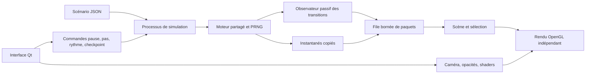

# Interface de visualisation durable — lot GUI1

État du29 octobre2026 : **socle fonctionnel, interface globale encore en cours**.
Ce lot construit l'outil final d'exploration et de préparation de captures.
Il ne produit pas encore la nouvelle démo biologique intégrée. Les anciens
démonstrateurs Pygame restent disponibles et inchangés.

## Lancer

Installer une fois avec `install_visualizer.bat`, puis ouvrir `visualizer.bat`.
Choisir un scénario JSON via **Ouvrir** ; la simulation démarre en pause.
On peut ouvrir un scénario existant directement :

```powershell
python -m visualizer --config demonstrators/configs/construction.json
```

Ce scénario est un exemple technique historique, pas la représentation de
l'avancement intégré actuel. Chaque nouvelle ouverture ou recommencement
crée un dossier distinct dans `outputs/visualizer/`, jamais une réécriture des
preuves de recherche. L'interface utilise le vrai moteur `Simulation.advance`.

## Fonctions livrées et commandes

| Fonction | État GUI1 |
|---|---|
| Grande fenêtre redimensionnable, plein écran | Livré, F11 |
| Zoom centré sur le curseur, déplacement XY | Livré, molette / glisser gauche |
| Vue globale, pause/reprise, un pas | Livré, F / Espace / N |
| Ralenti ou débit maximal sans changer dt | Livré, vitesse cible en unités simulées/s ; débit réel limité par le moteur |
| Opacité par espèce élémentaire | Livré, sliders indépendants |
| Sélection de particule ou assemblage structurel lié | Livré, clic et option Assemblage lié |
| Suivi de la sélection, atténuation du reste | Livré ; un glissement désactive le suivi de caméra |
| Partenaires liés temporairement | Livré pour partenaires directs des liaisons pairing ; contacts non liés à venir |
| Création/rupture des liaisons et état libre/lié | Flashes distincts et journal cliquable, lus à chaque tick de réaction |
| Style graphique | Sprites GPU adoucis, halo discret, style plat et repères commutables |
| Capture PNG de la scène sans panneaux | Livré, avec JSON de contexte caméra/scénario/temps ; pas une recette exacte de trajectoire |
| Mode présentation | Livré, Tab masque panneaux/barres ; F11 gère séparément le plein écran |
| Checkpoint de simulation | Sauvegarde via Fichier ; chargement dans la nouvelle GUI à venir |

Les identifiants sont les indices persistants des billes dans le moteur actuel,
stables pendant la session. Après une rupture, le suivi garde sa particule
d'ancrage et recalcule son assemblage structurel. Les liaisons `pairing` sont
traitées comme partenaires temporaires, pas comme squelette de la molécule.
Les attaches virtuelles du modèle historique à faces doubles sont projetées
à leur position réfléchie réelle ; elles ne sont pas ajoutées au nombre de billes.
Les regroupements moléculaires plus riches et le futur ajout/suppression de
billes demanderont un contrat d'identifiants explicite, sans identité biologique
dans la dynamique.

Les flashes durent environ0,22 seconde de présentation à réception. Le temps
simulé exact est dans le journal ; un événement ne se produit pas nécessairement
à l'instant où son paquet arrive. Une formation puis rupture entre deux images
peut être visible, car l'observateur lit les liens à chaque tick réactionnel.
Les états intermédiaires créés puis détruits **dans un même tick** ne sont pas
reconstitués par cette comparaison avant/après. Un flux natif de mutations
sera nécessaire pour garantir un flash de chaque transition élémentaire.
Le compteur des événements non transmis expose les débordements, il ne mesure
pas l'absence de réaction. Les flashes visibles sont bornés à512 et le journal
à100 entrées ; ces limites d'affichage ne sont pas une archive exhaustive.
Les réactions sans effet sur les liens/états exposés ne sont pas inventées.

## Architecture et choix techniques

Qt/PySide6 fournit fenêtre, panneaux, contrôles, haute densité de pixels et
événements souris/clavier. ModernGL utilise OpenGL3.3 : particules et liaisons
en quadrilatères instanciés, sans appel de dessin Python par bille. Les shaders
et paramètres de style sont séparés des données et du moteur. Ce choix permet
de faire évoluer ombrage, halo ou passes supplémentaires sans changer la chimie.



| Module | Responsabilité |
|---|---|
| `visualizer/worker.py` | Processus propriétaire du moteur ; transport borné, rythme d'exécution |
| `scene.py` | Copies de positions, catégories chimiques, graphes et transitions passives ; sélection |
| `camera.py` | Transformations XY/zoom indépendantes du toolkit |
| `renderer.py`, `shaders/` | Rendu GPU, buffers réutilisés, temps de présentation explicite |
| `app.py` | Widgets, commandes, inspection, journal et export PNG |

Aucun module du moteur n'importe Qt ou ModernGL. Positions GPU en float32
uniquement dans les copies de dessin ; mécanique et PRNG conservent leurs types
et leur ordre. Les filtres ne suppriment aucune particule des interactions.
Le processus graphique peut ralentir ou perdre des images sans changer les
résultats après le même nombre de pas. L'observateur de transitions ajoute un
coût de lecture, sans appeler le PRNG ou réécrire les liaisons.

La file contient deux instantanés au maximum ;4096 transitions en attente sont
conservées par le travailleur, avec compteur de perte si débordement. Il n'y a
pas d'enregistrement dense permanent. La lecture des graphes à chaque tick est
actuellement O(E), le transport copie des tableaux : cela devra être profilé
avant des bains massifs. Buffers partagés, deltas natifs du moteur et sélection
spatiale indexée sont des évolutions possibles, pas des capacités déjà mesurées.

Le renderer ne dépend ni de Qt ni du moteur et reçoit un temps de présentation
explicite. Il pourra viser un framebuffer hors écran pour l'export vidéo avec
cadence fixe, sans capturer les panneaux ni dépendre du débit de simulation.
Le client de relecture et l'encodeur restent à implémenter.

## Suite de la GUI avant la première nouvelle démo intégrée

- Relecture du nouvel état visuel, navigation temporelle et transitions rejouées.
- Flux de mutations natif et borné pour les transitions intermédiaires au sein
  d'un tick, et collecte plus efficace que la comparaison complète des graphes.
- Export d'animation déterministe à FPS/résolution choisis, métadonnées et encodeur
  optionnel ; capture de toute la scène ou d'une caméra locale.
- Inspection des sites/ports et contacts non liés, regroupements de visibilité
  moléculaires, retour clair sur les structures préparées et produites.
- Reprise de checkpoint dans ce client, préférences de vue et ergonomie à affiner.
- Courbes cinétiques comme panneau facultatif indépendant, après le socle.
- Ensuite seulement, scénario(s) minimalement nombreux illustrant l'intégration
  scientifique actuelle, avec ses dégradations et capacités manquantes visibles.

L'interface n'est donc **pas déclarée terminée**. La priorité reste sa finition,
pas une nouvelle exploration de lois ou une démo qui embellit les résultats.

## Vérification

`python -m unittest tests.test_visualizer -v` vérifie le zoom, la séparation
sélection/physique, les transitions entre images et le travailleur réel
(pause/pas/rythme, positions finales et PRNG exacts). Qt n'est pas requis pour
ces tests de contrat. `python experiments/smoke_visualizer.py` exerce la vraie
fenêtre et exporte des captures dans `outputs/visualizer_qa/`.
Validation GUI1 :106 tests logiciels et7 historiques passent, avec test natif
Qt/OpenGL d'interaction et capture ; aucune modification du paquet `simulator/`.

`python experiments/benchmark_visualizer.py` mesure uniquement le rendu sur
scènes synthétiques, avec upload des buffers et fin du travail GPU. Premier
relevé Intel UHD,1920×1080 :2000 billes/1999 liens ≈0,81ms ;10000/9999 ≈2,56ms ;
100000/99999 ≈26,4ms, soit≈38 images/s, en trois appels de rendu. Ce test court
ne mesure ni physique, ni IPC, ni sélection, ni collecte des transitions, et ne
garantit pas le débit d'une future cellule complète. Données et hashes locaux.

Références techniques : [QOpenGLWidget](https://doc.qt.io/qtforpython-6/PySide6/QtOpenGLWidgets/QOpenGLWidget.html)
et [instanciation ModernGL](https://moderngl.readthedocs.io/en/latest/reference/vertex_array.html).
