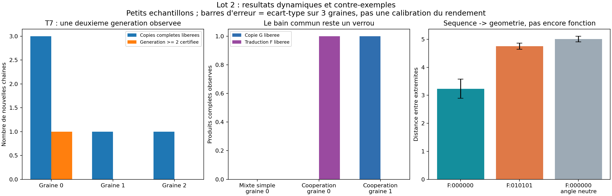
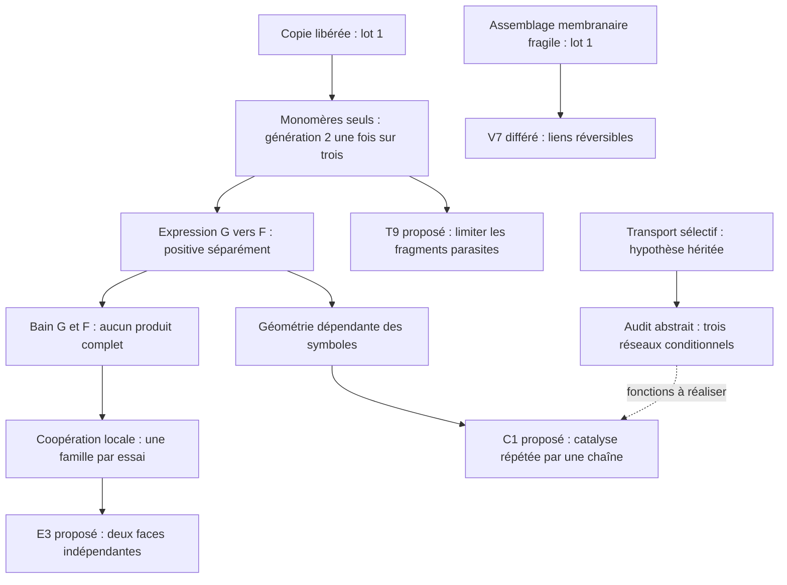

# Lot 2 — copie, expression et cahier des charges de fermeture

23 octobre 2026. **20 nouvelles simulations dynamiques, aucun incident technique**,
plus un audit abstrait de trois architectures. Les références exactes des essais
sont figées dans [BATCH_02.json](BATCH_02.json). Le registre total conserve 52
dossiers, dont quatre incidents antérieurs au démarrage de la dynamique.

**Maturité : preuves de principe partielles, encore précoces.** La copie peut
atteindre une deuxième génération ; l'expression produit une autre famille de
polymères ; la séquence affecte leur géométrie. Nous n'avons encore ni catalyseur
fonctionnel exprimé, ni fabrication des composants depuis la nourriture, ni
coexistence démontrée de copie et expression dans le même essai.

## Arbre des décisions du lot

Les flèches expriment les dépendances de recherche, pas une validation physique
des branches proposées. Le registre détaillé reste [branches.json](branches.json).

## T7 — recrutement des monomères et filiation stricte

Changement issu de l'ancien moteur : un nouvel appariement ne peut se former
qu'entre un support localement polymérisé et une sous-unité libre. L'appariement
peut ensuite persister lorsque la sous-unité recrutée est ligaturée. Cette règle
est symétrique ; aucun rôle parent/copie n'est attribué aux particules.

À t=800, séquence 001011, 48 monomères G préparés :

| Graine | Nouvelles copies complètes libérées | Dont deuxième génération certifiée |
| --- | ---: | ---: |
| 0 | 3 | 1 |
| 1 | 1 | 0 |
| 2 | 1 | 0 |

Le contrôle T4 à la même durée, graine 0, donne une copie complète libérée sans
deuxième génération certifiée. Cette comparaison unique soutient la modification,
sans établir un gain général de rendement. Des fragments courts restent nombreux.

La certification est une **analyse de provenance**, sans effet sur les forces :
chaque liaison du descendant doit avoir été soutenue par le même parent complet,
déjà observé et encore intact. Une ligation isolée sur une copie, ou un descendant
assemblé à partir de plusieurs parents, ne suffit plus. Le résultat montre une
possibilité sur une graine parmi trois, pas encore une lignée persistante.

## E0/E1 — expression directe et géométrie des produits

Deux types chimiques de supports G/F partagent deux symboles de reconnaissance.
Une arête G peut favoriser une ligation parallèle G-G ou F-F ; les squelettes
mixtes G-F sont interdits. F ne sert pas de matrice. La table locale G→F est une
traduction directe symbole à symbole, sans adaptateur ni codons.

À t=600 avec uniquement des monomères F préparés, le gène 001011 produit deux
chaînes F exactes et libérées, graine 0. Le contrôle sans squelette génétique
initial ne produit aucune ligation. La séquence 010010 produit aussi deux chaînes
F libérées, graine 1. Les chaînes sont reconnues à inversion près.

Un helper local donne aux supports F une préférence angulaire dépendant du
symbole : cosinus cible +0,3 pour 0, −0,3 pour 1. L'appariement masque cette
préférence pendant la synthèse. Avec ce helper, une chaîne F issue de 001011 est
encore exprimée et libérée, graine 1.

Neuf essais distincts sur des chaînes F préparées, trois graines par condition,
testent l'organisation à t=100, température 0,2 :

| Chaîne et règle | Distance moyenne entre extrémités ± écart-type |
| --- | ---: |
| 000000, préférence native | 3,235 ± 0,341 |
| 010101, même table native | 4,754 ± 0,105 |
| 000000, préférence nulle | 5,010 ± 0,102 |

La séquence modifie donc la géométrie dans ce modèle. Ces états finaux ne prouvent
ni un repliement unique, ni une activité chimique, ni un cycle catalytique.

## E0mixed/E2 — contre-exemple à la compatibilité des deux fonctions

Dans le bain de 24 G et 24 F, E0mixed, graine 0, ne produit aucune chaîne complète
G ou F à t=600. Les appariements voisins du gène recrutent souvent des familles
différentes, incapables de former leur liaison parallèle. Parmi 3 478 observations
de voisins simultanément occupés sur le gène initial, 2 719 sont incompatibles
(78,2 %). Ces instantanés corrélés ne sont pas des essais indépendants ; le
changement de concentration de chaque famille reste aussi un facteur possible.

E2 teste une modification ciblée : le type d'une sous-unité entrante doit être
compatible avec les partenaires des voisins directement liés. Ce helper local
élimine les interfaces incompatibles observées, mais produit seulement une chaîne
F libérée en graine 0 et une chaîne G libérée en graine 1. **Aucun des deux essais
ne montre les deux productions.** La coopération semble déplacer le problème
vers la sélection d'une famille ; la cause détaillée reste à isoler.

Décision : ouvrir E3, deux faces locales de recrutement indépendantes, avant de
déclarer une chimie commune viable. E3 n'est pas encore implémentée.

## C0 — réseau de cellule conditionnel

[CELL_ARCHITECTURE.md](CELL_ARCHITECTURE.md) compare deux familles avec quatre
outils spécialisés, deux familles avec deux outils supposés polyvalents, et une
famille R combinant information et fonction. Les trois réseaux passent l'audit
de matière, de production de chaque classe essentielle et de régénération des
outils, avec un flux de remplacement explicite. Quinze contrôles négatifs
détectent la perte d'un producteur, une matière incorrecte ou un monomère élaboré
dissimulé dans la nourriture.

Ces fonctions catalytiques sont **supposées dans le réseau abstrait**. Elles ne
sont pas implantées comme réactions macro dans le moteur de particules. Le coût
comptable de remplacement n'est ni un rendement ni une preuve de minimalité.
Le candidat à quatre outils devient une liste explicite de fonctions à réaliser ;
les variantes compacte et R restent ouvertes.

## Vérification et décisions suivantes

Les quatre vérifications mécaniques et trois tests de l'observateur passent.
Le rejeu des sources archivées d'E1zero, graine 0, reproduit exactement toutes
ses métriques. Chaque simulation conserve configuration, graine, sources et
SHA-256, événements et trajectoire. L'audit abstrait archive aussi sa source.
Les 104 empreintes des sources des 52 dossiers et celle de l'audit abstrait
concordent ; toutes les références du manifeste existent. Les vérifications sont
consignées dans [BATCH_02_VERIFICATION.json](BATCH_02_VERIFICATION.json).

Priorité suivante : **C1**, une chaîne dont l'organisation accélère une opération
locale répétée et libère son produit, avec variantes de séquence et contrôle sans
chaîne. En parallèle conceptuel, **E3** doit résoudre la concurrence copie/expression.
T9 (fragments parasites), V7 (réversibilité membranaire) et M0 (perméabilité)
restent ouverts. Voir [PRIORITIES.md](PRIORITIES.md), [MATURITY.md](MATURITY.md)
et [branches.json](branches.json) pour reprendre la recherche.
