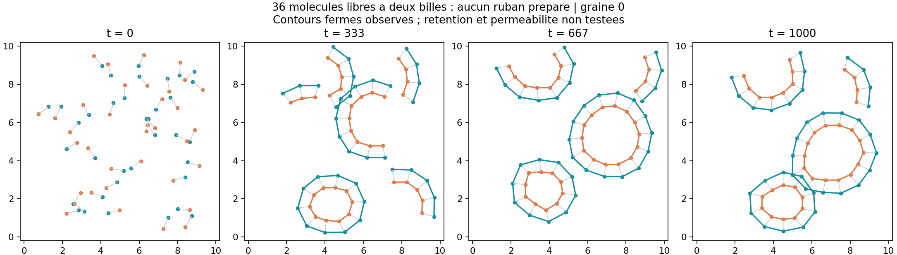
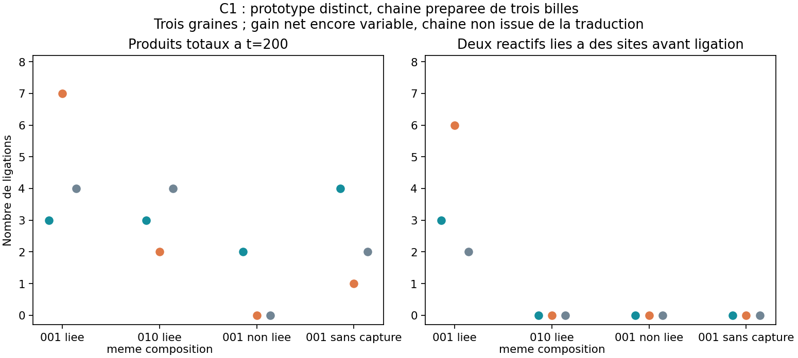

# Lot 3 — assemblage depuis des molécules libres et ligation géométrique

23 octobre 2026. **35 dynamiques achevées, zéro incident.** Les entrées exactes
et sources figées sont référencées dans [BATCH_03_RECIPES.json](BATCH_03_RECIPES.json).
Les données restent locales ; les deux figures sont des synthèses éditoriales.
Hypothèses initiales : [plan](BATCH_03_PLAN.md).

## V8 : fermer depuis des dimères isolés

Le démonstrateur précédent repliait un ruban déjà polymérisé. V8 commence avec
des molécules H–T de deux billes, dispersées et orientées aléatoirement, **aucune
liaison latérale**. Chaque dimère porte deux faces géométriques, définies par
son axe H–T. Un contact coopératif de quatre billes rapproche simultanément
les sites des deux rangées ; une capture locale lie les deux rangées et sature
les faces. Les espacements préférés différents induisent la courbure.

Helpers déclarés : faces saturables, capture coopérative, rupture sous extension
et éventuellement thermique ; superpositions sélectives et murs de boîte.
Le potentiel et son gradient sont explicités dans [MODEL.md](MODEL.md).
Aucun contour, composant connexe, nombre cible de molécules ou angle de boucle
n'intervient dans les forces ou réactions.

Le point retenu utilise 36 molécules dans une boîte 10×10, température 0,08,
espacements 1 et 0,65, attraction 4, largeur 0,3, capture 0,25, rupture thermique
0,02 ; durée 1000, pas 0,002. Les trois graines sont distinctes ; le rejeu du
scénario de démonstration est un doublon de la graine 0, pas une quatrième graine.

| Graine | Tailles des contours finaux | Aires finales | Première fermeture échantillonnée | Plus longue fermeture échantillonnée du même contour | Molécules en contours à la fin |
| --- | --- | --- | ---: | ---: | ---: |
| 0 | 10, 14 | 7,93 ; 14,36 | 184 | 275 | 24/36 |
| 1 | 11 | 9,48 | 169 | 201 | 11/36 |
| 2 | 12, 10 | 10,98 ; 8,07 | 175 | 292 | 22/36 |



L'analyse exige deux rangées fermées correspondantes, des polygones simples
et une aire de la rangée H supérieure à 1. Pour la persistance, elle suit
l'identité exacte des molécules de chaque contour. Les positions et liens sont
échantillonnés toutes les unités de temps : **des ouvertures entre images restent
possibles**. Ces résultats établissent l'assemblage de contours, sans démontrer
la rétention d'un contenu, la perméabilité, la croissance ou la réparation.
Des molécules restent en chaînes ouvertes ; tout le stock ne ferme pas ensemble.

### Pistes défavorables et ablations conservées

| Variante | Essais | Résultat et décision |
| --- | --- | --- |
| 24 molécules, espacement court 0,75 | 2 graines à t=300, puis 2 à t=1200 | Aucune fermeture ; allonger la durée ne suffit pas |
| Capture élargie, même stock | 1 à t=300 | Aucune fermeture |
| Sans rupture thermique, même stock | 1 à t=300, 1 à t=1200 | Aucune fermeture |
| 36 molécules, espacement court 0,75 | 3 à t=1200 | Fermeture au moins une fois sur 3/3, mais seulement 2/3 à la fin |
| Espacements égaux, 24 molécules | 1 à t=1000 | Aucune fermeture ; densité différente, contrôle exploratoire |
| Espacements égaux, 36 molécules | 1 à t=1000 | Aucune fermeture ; contrôle à densité égale du point retenu |
| Point retenu sans attraction | 3 à t=1000 | Contours finaux sur 2/3 : l'attraction n'est pas nécessaire à leur existence |
| Point retenu sans rupture thermique | 1 à t=1000 | Deux contours finaux, 12 et 13 molécules ; rupture sous extension toujours active |

La courbure et la concentration ont été changées pendant l'exploration : leur
contribution n'est pas isolée par le seul succès final. Trois graines favorables
ne constituent pas une estimation robuste du rendement. Les ablations empêchent
de présenter l'attraction ou la rupture thermique comme nécessaires ; la branche
V9 conserve cette question de minimalité. V7 sur l'ancien modèle V6 reste ouverte.

**Livraison :** `02_membrane.bat` calcule maintenant cet assemblage depuis les
molécules isolées. `07_ruban_prepare.bat` conserve l'ancien contrôle de repliement.

## C1 : forme d'une chaîne et ligations répétées

Ce second front utilise le même moteur, mais **un prototype chimique séparé** :
trois billes F simples déjà liées, et non les sous-unités composites G/F du modèle
de traduction. La table locale des angles dépend du symbole central. La séquence
001 rapproche ses extrémités ; 010, de même composition, garde une forme ouverte.
Les symboles 0/1 capturent respectivement X/Y. La réaction X+Y→XY a exactement
la même distance et probabilité partout, sans test de chaîne ou d'enzyme.

La formation du lien produit supprime localement l'affinité de capture : c'est
un **helper explicite de libération**, pas une libération découverte sans règle.
Les précurseurs sont activés et la ligation irréversible ; le bilan énergétique
et l'approvisionnement ne sont pas modélisés. Les billes sont conservées.

Huit X et huit Y, boîte 10×10, température 0,2, durée 200. Résultats par graines
0/1/2 ; les trois sites libres gardent les mêmes affinités élémentaires.

| Condition | Produits totaux | Ligations avec les deux réactifs capturés |
| --- | --- | --- |
| Chaîne 001 | 3 / 7 / 4 | 3 / 6 / 2 |
| Chaîne 010, même composition | 3 / 2 / 4 | 0 / 0 / 0 |
| Sites 001 non reliés | 2 / 0 / 0 | 0 / 0 / 0 |
| Chaîne 001 sans capture | 4 / 1 / 2 | 0 / 0 / 0 |



Les événements co-capturés de 001 utilisent les deux extrémités de la même chaîne,
avec des paires de substrats distinctes : préorganisation, ligation et libération
répétées sont observées sur trois graines. Le rendement total dépasse 010 sur une
seule graine et lui est égal sur les deux autres ; **l'accélération globale robuste
n'est pas établie**. Deux essais exploratoires 011 produisent 2/0 produits, sans
co-capture ; leur composition différente empêche d'en faire le contrôle principal.

Le premier compteur conditionnait la co-capture à la présence du squelette. Tous
les événements ont donc été recomptés à partir des deux identités de support,
y compris dans le contrôle sans squelette. Le compteur actuel distingue co-capture
et support par chaîne ; une nouvelle validation graine 1 retrouve 7 produits,
6 co-capturés et 6 soutenus par chaîne. Les archives antérieures restent intactes.

Ce mécanisme n'a pas encore été transféré aux F composites, exprimé depuis G,
ni utilisé pour fabriquer un composant utilisable ou un autre outil.
`08_ligation_preparee.bat` permet de voir ce prototype avec la graine 1 ;
sa description rappelle qu'il reste distinct du modèle de traduction.

## Validation, traçabilité et décisions

24 tests passent : 17 moteur/nouvelles chimies, 4 mécaniques et 3 observateur.
Les nouveaux tests vérifient gradients, force/couple totaux, saturation des faces,
départ sans liens latéraux, égalité arbre/exhaustif, reprise exacte et conservation
des billes. Le contrôle d'interface hors écran compare travailleur et headless.
Le rejeu intégral de C1 depuis ses sources archivées vérifie toutes les métriques.

Le résultat et son checkpoint utilisent maintenant les empreintes de la copie
de sources figée au début du run ; une édition du code de développement pendant
le calcul ne change plus les empreintes finales. Un test couvre ce cas.
Les 35 recettes conservent leurs sources exactes ; trajectoires, résultats complets
et checkpoints restent ignorés par Git.

Exemples de reconstruction depuis un clone sans données (Python 3.12 avec les
dépendances du projet) :

```powershell
python scripts/reconstruct_experiment.py research/engine_runs/V8curved_s0_20261023T152149015398Z
python scripts/reconstruct_experiment.py research/engine_runs/C1_validation_final_s1_20261023T154512527869Z
```

Les nouvelles données vont dans `outputs/reconstructed/`. Pour relancer une
variante avec les lois actuelles : `python experiments/run_batch3.py V8curved
--seed 1 --duration 1000` (une seule ligne). Le manifeste fige les 35 essais du
bilan ; `make_batch3_report.py` relit leurs données locales pour refaire la synthèse.

**Maturité : encore partielle.** L'assemblage membranaire demandé est atteint à
un point de fonctionnement ; une fonction géométrique répétée a une preuve de
principe séparée. Les priorités sont son transfert aux F exprimables, la coexistence
copie/expression et une mesure de rétention membranaire. La fabrication et le
renouvellement des outils depuis la nourriture restent sans réalisation physique.
