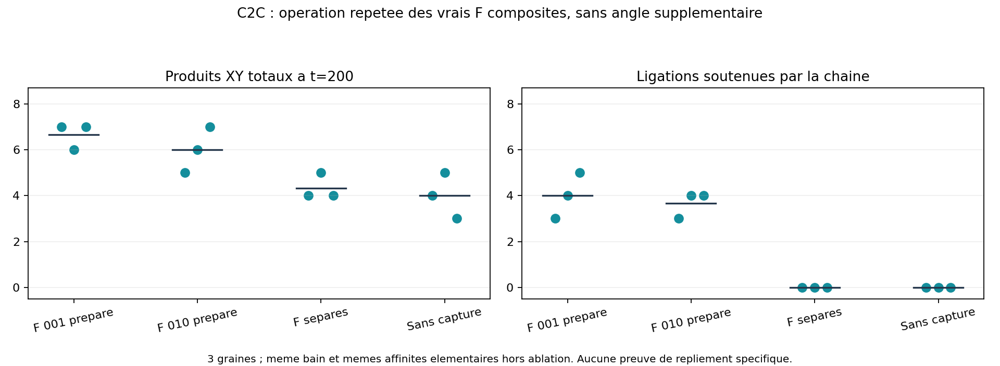
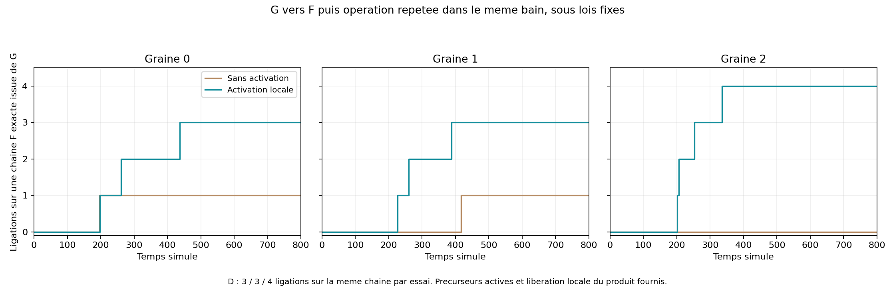
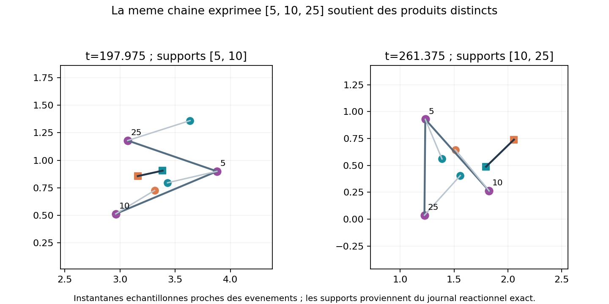

# Lot 4 — une chaîne F exprimée réalise des opérations répétées

23 octobre 2026. **53 dynamiques achevées, zéro incident de simulation.** Les
[recettes et sources figées](BATCH_04_RECIPES.json) permettent leur reconstruction ;
les données complètes restent locales. [Plan avant essais](BATCH_04_PLAN.md),
[décisions intermédiaires](BATCH_04_DECISIONS.md).

**Progrès : G→F puis ligations répétées par le F fabriqué, dans le même bain sous
des lois fixes, sur trois graines.** Les F sont les véritables dimères composites
du hook de copie/traduction. Aucun outil F complet n'est fourni à l'initialisation.
L'opération produit XY, encore inutilisable comme monomère du modèle ; elle ne
réalise pas la production des composants ni le renouvellement des outils.

## Arbre des décisions

| Candidat | Modification | Résultat et décision |
| --- | --- | --- |
| C2A | Capture/ligation C1 sur les reconnaisseurs des F composites ; angle natif de squelette | Préparé et permuté : une ligation co-capturée chacun en graine 0, t=200 ; pas de cycle répété démontré |
| C2B | Réutilisation des angles E1 pour orienter les reconnaisseurs, cosinus 0,8 pour les deux symboles | Chaîne préparée : 5 ligations co-capturées par graine 0/1/2 ; les supports sont surtout adjacents, rôle de l'angle ajouté non établi |
| C2C | Suppression de l'angle supplémentaire, maintien des seuls angles E1 | Préparé : 3/4/5 ligations co-capturées ; exprimé : 1/1/0 sur chaîne exacte. Simplification conservée |
| C2C, pool réduit | 6 ou 12 F au lieu de 24, mêmes lois, graine 0, t=1000 | 0 ou 1 F exact libéré ; aucune opération par chaîne exacte. Ce changement de stock ne résout pas le verrou dans ces essais |
| C2D | Activation de capture par voisin de squelette ; affinités des F libres affaiblies | Chaînes exprimées et utilisées 3/3/4 fois par une même chaîne, graines 0/1/2 à t=800. Candidat d'intégration retenu |

Le helper D est une extension de l'activation locale déjà utilisée en copie,
pas une reconnaissance de fonction. Il répond à l'interférence observée : dans
C, des F monomères distincts capturent et consomment les substrats. Les contrôles
sans activation montrent que la géométrie seule ne suffit pas à un couplage répété
aux réglages testés. Cela ne prouve pas que ce helper est nécessaire dans tout univers.

## Fonction portée par des F composites préparés

C2C, t=200, graines 0/1/2, température 0,6 et boîte 8×6, mêmes lois hors ablation :

| Condition initiale | Produits XY totaux | Ligations avec les deux réactifs capturés par la même chaîne |
| --- | --- | --- |
| F 001 préparé | 7 / 6 / 7 | 3 / 4 / 5 |
| F 010 préparé, même composition | 5 / 6 / 7 | 3 / 4 / 4 |
| Trois F 001 non reliés, mêmes affinités élémentaires | 4 / 5 / 4 | 0 / 0 / 0 |
| F 001 sans capture | 4 / 5 / 3 | 0 / 0 / 0 |



La liaison entre sous-unités préorganise des sites capables de plusieurs opérations
avec libération. Le gain final face aux sites séparés est favorable sur ces trois
graines, sans estimation statistique robuste. 010 fonctionne aussi : **aucune
supériorité spécifique de 001 ni nécessité d'un repliement particulier n'est
établie**. La plupart des contacts productifs utilisent des voisins de squelette.
Il s'agit d'une fonction d'assemblage relativement simple, pas d'une bibliothèque
de protéines à fonctions variées déjà obtenue.

## Expression et usage sous les mêmes lois

C2D : G 001 préparé, 24 F monomères, 8 X et 8 Y, aucun F polymérisé au départ.
Mêmes paramètres que C, avec activation locale des sites par une liaison de
squelette. Durée 800 ; pas 0,005 ; cycle externe prédéfini de période 200, fenêtre
de déliaison 15. Aucune bascule commandée par la détection d'un produit complet.

| Graine | F exacts libérés | Ligations sur F exact fabriqué depuis G | Maximum par une même chaîne | Produits XY totaux |
| --- | ---: | ---: | ---: | ---: |
| 0 | 2 | 3 | 3 | 8 |
| 1 | 4 | 3 | 3 | 7 |
| 2 | 3 | 4 | 4 | 8 |



En graine 0, les sous-unités [5,10,25] du F exprimé soutiennent trois produits
distincts à t=197,975, 261,375 et 437,575. Les supports changent entre sites de
cette même chaîne ; le produit sort après la ligation et les sites sont réutilisés.



La certification est analytique : chaîne F exacte et détachée, sans matière du
gène initial, chaque arête fabriquée par une ligation soutenue par le même parent
G complet ; deux réactifs réellement capturés par ses sites au moment de la
réaction. Les événements mémorisent ces supports. La dynamique ne lit ni cette
certification ni une identité de chaîne. Les produits sont distincts et les
billes ne sont pas créées ou détruites.

Contrôles C2D :

- Sans gène polymérisé, graines 0/1/2 : aucun squelette F produit, aucune réaction
  co-capturée ; pourtant 7/7/8 produits spontanés. Le simple nombre de produits
  XY à t=800 ne prouve donc **pas une accélération globale utile**.
- Sans capture des substrats, graine 0 : quatre F exacts libérés mais aucune
  opération soutenue par eux ; sept produits de bain.
- G 010 au lieu de 001, graine 0 : trois F exacts libérés, deux opérations par
  une même chaîne exprimée. Variation positive isolée, pas robustesse établie.
- Sans activation (C), mêmes pools et durée, graines 0/1/2 : deux F exacts libérés
  par essai, mais 1/1/0 opération sur une chaîne exacte, jamais plusieurs par
  une même chaîne.

Le contrôle sans gène D n'isole pas la géométrie : l'activation affaiblit aussi
les affinités des F non polymérisés. La comparaison géométrique à affinités
identiques est celle de C, conservée séparément.

## Lois communes, coût et régressions

Le candidat D utilise le hook `copy` existant, avec les vrais supports G/F et leurs
reconnaisseurs binaires. `substrates.py` ajoute une interaction locale à ce hook,
sans second ordonnanceur ni passage entre deux représentations de F.

Ajouts matériels : X/Y, deux espèces de ressources à un bit, et l'occupation d'un
reconnaisseur F par un substrat. Occupations génétique et alimentaire exclusives.
Sept paramètres de capture/réaction sont exposés ; constantes mécaniques C1 reprises
(exclusion 0,15 ; ressorts 35 et 80 ; longueur produit 0,18). L'affinité change
localement après formation du produit. Ressources activées et réaction irréversible
fournies, sans bilan énergétique complet. Dans D, le facteur d'activité vaut 1
pour un F lié et 0,1/35 sans voisin ; sa déliaison vaut au moins 5 dans ce dernier
état. Ces nombres sont repris de l'activation historique, mais leur extension
aux substrats reste un helper explicite.

Le candidat retenu n'utilise **aucun angle de squelette supplémentaire** et les
deux symboles ont le même angle E1, cosinus 0,8. Les options exploratoires A/B
restent disponibles et archivées ; elles ne sont pas des primitives actives de D.

| Référence sous les lois D | Résultat | Portée |
| --- | --- | --- |
| Copie G 001011, 48 G libres, t=800, graine 0 | Une copie complète libérée ; aucune génération deux certifiée | Acquis de première copie conservé |
| Expression 001011, 48 F libres, sans X/Y, t=600, graine 0 | Deux F exacts libérés | Expression conservée avec nouvelle géométrie native |
| Expression 010010, mêmes pools, graine 1 | Trois F exacts libérés | Autre séquence conservée |
| F préparé 001 et 010, t=200, graine 0 | Mêmes résultats que C, 3 réactions soutenues chacun | Contrôle direct du transfert vers D |
| Copie G + expression F dans un même bain | Non testé dans ce lot ; échec antérieur non résolu | E3 reste ouvert |
| Membrane avec cette chimie | Non intégré | Succès V8 antérieurs conservés séparément |

Les stocks et séquences peuvent changer comme conditions initiales. La table des
lois reste fixe ; les essais sans X/Y correspondent à l'absence initiale de ces
ressources, pas à une désactivation de leurs interactions. Les anciennes formes
E1 avec cosinus ±0,3 ne sont pas promises sous la nouvelle table 0,8/0,8. Aucune
preuve nouvelle de repliement spécifique n'est revendiquée.

## Vérification et reproduction

28 tests passent : 21 tests du moteur/chimies, 4 mécaniques et 3 observateur.
Nouveaux contrôles : gradient de capture sur les vraies billes, exclusivité des
occupations, libération, arbre/exhaustif, reprise exacte avec activation, et
rejet d'une chaîne exacte sans provenance de traduction. Interface hors écran
et relecture avec substrats vérifiées. Les rejeux préparé et exprimé comparent
toutes les métriques ; les 1007 empreintes de sources des 53 recettes sont vérifiées.
Le premier lancement des tests a rencontré une restriction d'écriture temporaire
Windows ; leur relance autorisée passe, sans incident physique attribué à ce cas.
La reconstruction de C2expressD graine 0 depuis ses seules entrées retrouve
toutes les métriques et tous les tableaux de trajectoire. Le nouveau démonstrateur
complet passe ses critères. La référence copie G retrouve aussi exactement les
métriques et tableaux de sa trajectoire migrée W0 antérieure.

```powershell
python experiments/run_batch4.py C2express --candidate D --seed 0 --duration 800
python scripts/reconstruct_experiment.py research/engine_runs/C2expressD_s0_20261023T162849776253Z
```

`09_expression_fonction.bat` montre le couplage avec la même graine. Les données
ne sont livrées ni dans Git ni dans le paquet ; recettes, code et ces figures de
synthèse suffisent à les reconstruire.

**Maturité : première intégration matérielle expression→opération répétée.**
Il manque encore un produit réellement utilisable pour fabriquer les composants,
la régénération des outils, la coexistence copie/expression et une membrane
fonctionnelle intégrée. E3 devient le prochain test prioritaire ; C3 ouvre la
production d'un composant utilisable, sans assimiler le produit XY à cet acquis.
