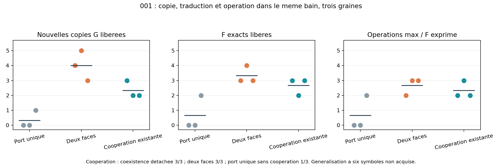

# Lot 5 — coexistence courte, simplification et santé du projet

24 octobre 2026. **30 dynamiques de recherche achevées**, sans erreur du moteur.
Trois scénarios ont une erreur d'étiquette identifiée et conservée : voir ci-dessous.
[Recettes et sources](BATCH_05_RECIPES.json), [plan](BATCH_05_PLAN.md),
[décisions pendant les essais](BATCH_05_DECISIONS.md), [santé du projet](PROJECT_HEALTH.md).

**Sur 001, copie G, traduction F et opérations par les F exprimés coexistent
dans un même bain sur trois graines.** La solution retenue réutilise la coopération
locale existante, avec un seul port. La généralisation à six symboles reste ouverte.

## Hypothèses testées et choix

Le conflit de recrutement G/F peut être traité de deux façons : séparer les faces
de capture (E3A) ou garder une interface dont les voisins liés favorisent la même
famille de produit (E3C, helper E2 réutilisé). Les deux modèles partagent les vrais
G/F composites et la capture X/Y de C2D. Le moteur Simulation reste unique.

E3A crée deux occupations indépendantes : G–F sur R, G–G sur V=2P−R. Le site
virtuel est défini par les deux billes existantes et sa force est répartie par
le jacobien (2,−1). Pas de nouveau type élémentaire ni de reconnaissance d'agrégat.
Mais c'est un nouveau helper et un état d'occupation supplémentaire.

E3C conserve un seul appariement. Un entrant doit avoir la même famille que les
partenaires déjà appariés aux voisins directement liés du support G. Cette
coopération est bornée et locale ; elle ne lit ni séquence ni état de cellule.
Elle existait dans E2 mais n'avait pas encore été combinée et validée avec
l'activité C2D. Les deux fonctions restent permises sous les mêmes règles, sans
mode global copie/traduction. Le cycle externe de libération génétique reste fourni.

**Décision : retenir E3C comme référence suivante.** Il obtient le couplage court
avec moins d'états que E3A et conserve les références isolées. Les deux faces
restent une alternative archivée, pas une primitive nécessaire démontrée.

## Résultats à trois symboles

G 001 préparé, 24 G libres, 24 F libres, 8 X et 8 Y, boîte 8×6, température 0,6,
durée 800, pas 0,005, période externe 200 dont 15 de déliaison. Les F complets
et les nouvelles copies G ne sont pas présents au départ. Résultats par graines 0/1/2 :

| Candidat | G exacts libérés | F exacts libérés | G et F nouveaux détachés ensemble | Maximum d'opérations par F exprimé |
| --- | --- | --- | --- | --- |
| C2D, port unique sans coopération | 0 / 0 / 1 | 0 / 0 / 2 | non / non / oui | 0 / 0 / 2 |
| E3A, deux faces | 4 / 5 / 3 | 3 / 4 / 3 | oui / oui / oui | 2 / 3 / 3 |
| E3C, coopération réutilisée | 3 / 2 / 2 | 3 / 2 / 3 | oui / oui / oui | 2 / 3 / 2 |



La coexistence demande une observation avec les deux nouveaux produits exacts
simultanément détachés. Une analyse indépendante des trajectoires confirme ce
critère ; E3C l'atteint dans les premières images à t=385,5 sur les trois graines.
La métrique ne se contente pas d'additionner des réussites à des instants disjoints.
Les réactions sur F sont certifiées comme au lot 4 par la provenance des arêtes
et les supports réellement capturés. E3C a 2/3/3 opérations certifiées au total,
dont 2/2/3 alors qu'une nouvelle copie G complète est présente.

Les trois graines E3C ont aussi un descendant G de génération deux certifié,
sur cette **séquence courte**. Ce résultat n'est pas directement comparable à
la réplication de 001011, ni à une lignée maintenue sous dégradation.

La troisième graine du port unique réussit également : les nouveaux helpers
ne sont pas nécessaires à la simple possibilité du couplage. Trois graines par
réglage ne suffisent pas à estimer un rendement robuste général.

## Longueur six : le verrou reste visible

Même bain, G 001011 préparé, durée 1200, graines 0/1 :

| Candidat | G exacts libérés | F exacts libérés | Opérations par F exact exprimé |
| --- | --- | --- | --- |
| Port unique sans coopération | 0 / 0 | 0 / 0 | 0 / 0 |
| Deux faces | 0 / 0 | 0 / 0 | 0 / 0 |
| Coopération réutilisée | 0 / 0 | 1 / 1 | 3 / 0 |

Allonger la période d'association de 200 à 600, durée totale 1800, donne avec
deux faces 1/0 G et 0/0 F, graines 0/1 ; port unique graine 0 : aucun des deux.
Un délai plus long ne suffit donc pas à rendre les processus compatibles dans
ces essais. Il modifie le protocole environnemental, pas la famille chimique
permise au cours du temps.

Les essais six symboles à deux faces et période 600 finissent avec 20/24 et
18/24 des unités F dans des polymères incomplets. Les fragments libérés ne
peuvent pas être recrutés comme entrants quand seuls les monomères sont admis ;
les liaisons de squelette sont irréversibles. C'est un mécanisme plausible de
piégeage, **pas une attribution causale démontrée**. T9 (renouvellement/finition
des fragments) devient un risque prioritaire, pas un simple ajustement cosmétique.

## Contrôles, régressions et erreurs conservées

- F seuls, 001, deux faces : 3/3/1 F libérés, maximum 4/3/2 opérations par outil.
  L'activité exprimée est donc conservée dans ces essais isolés.
- F seuls, coopération, graine 0 : deux F libérés et trois opérations par un
  même outil. Toutes les métriques et tous les tableaux de trajectoire retrouvent
  exactement la référence C2D correspondante.
- G seuls, 001011, 48 G libres, t=800, graine 0 : une copie avec le port unique
  ou la coopération ; aucune avec les deux faces. Régression du point de
  fonctionnement E3A, sans preuve d'un échec général de ses autres graines.
- Sans gène polymérisé, graine 0 : ni copie ni F produit, ni opération soutenue,
  pour les deux faces et pour la coopération. Le fond produit pourtant 6 ou
  7 XY ; les produits spontanés ne sont pas attribués aux outils.
- Trois essais nommés E3dual6long (graines 0/1) et E3base6long (graine 0) ont
  réellement **001** dans leur scénario résolu, suite à une déduction erronée
  depuis le suffixe du nom. Ils restent archivés comme essais courts à période
  600 et ne soutiennent aucune conclusion sur six symboles. Les trois véritables
  essais six symboles ont été relancés sous les noms `*6extended`.

La sélection des scénarios est maintenant une table explicite ; les noms inconnus
exigent une séquence explicite. Les paramètres chimiques et pools des scénarios
nommés sont également déclarés, plutôt que déduits d'un sous-texte du nom. Un test
vérifie ce contrat. Aucun ancien scénario ni source archivée n'est corrigé rétroactivement.

## Santé, coût et prochaine décision

Le progrès est une intégration de fonctions sous un même jeu de lois, avec
réutilisation d'un helper et abandon de la nouvelle géométrie comme obligation.
Il ne démontre ni capacité d'information extensible ni fermeture matérielle.
Ce lot comprend trois hypothèses principales (faces, durée d'association,
coopération réutilisée) et des contrôles automatisés ; trente runs ne sont pas
trente inventions de règles.

Le modèle actuel ne peut pas être la cellule finale : rungs, familles et monomères
sont assignés au départ, sans voie depuis X/Y/Z. La piste C3 est de construire
les composés par liens et états locaux entre billes persistantes, puis de les
incorporer réellement. Le flux utile, les fragments et le transport restent
des risques expérimentaux majeurs. [PROJECT_HEALTH.md](PROJECT_HEALTH.md) distingue
ces verrous du modèle actuel d'une impossibilité de principe.

**Appréciation : poursuite justifiée, trajectoire courte encore conditionnelle.**
Quelques dizaines de lots restent plausibles pour une cellule minimale construite,
sans pouvoir en faire une prévision fiable. Le prochain lot doit viser C3 et son
test matériel de décision ; ne pas ouvrir un long catalogue de fonctions avant
de connaître cette constructibilité. T9 et M0 restent les autres jalons de risque.

## Vérification et reproduction

33 tests passent : 26 moteur/chimies, 4 mécaniques, 3 observateur. Vérifications
spécifiques : gradient des sites réfléchis, force/couple totaux, occupation
simultanée des deux faces d'un G, arbre/exhaustif, reprise et détachement sur les
deux faces. Les 596 empreintes des sources des 30 recettes sont vérifiées.
La reconstruction E3C graine 0 depuis les seules sources et paramètres retrouve
exactement toutes les métriques et tous les tableaux de trajectoire.
Les références G seul et F seuls sous coopération retrouvent également leurs
trajectoires antérieures exactes. Le travailleur graphique et le calcul sans
interface sont identiques sur le contrôle court ; relectures et dessin des
sites réfléchis sont vérifiés hors écran.

```powershell
python experiments/run_batch5.py E3cooperative3 --seed 0 --duration 800
python scripts/reconstruct_experiment.py research/engine_runs/E3cooperative3_s0_20261024T114041549151Z
```

`10_coexistence.bat` calcule cette démonstration ; ses critères passent. Les
données brutes restent locales, seuls code, recettes, notes et figure de synthèse
sont versionnés. Aucun push.
