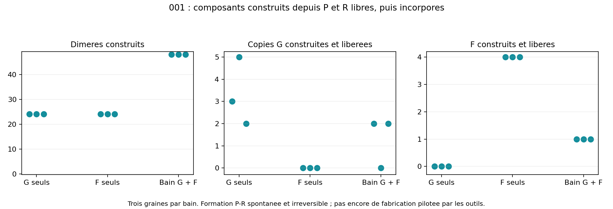

# Lot 6 — construire un dimère puis l'incorporer

25 octobre 2026. **19 dynamiques achevées, aucune erreur du moteur.**
[Plan](BATCH_06_PLAN.md), [recettes et sources](BATCH_06_RECIPES.json),
[décisions](BATCH_06_DECISIONS.md), [santé](PROJECT_HEALTH.md).

**Un premier verrou matériel est réduit : les monomères ne doivent plus être
des paires préassignées.** Des billes P et R indépendantes forment des dimères,
qui sont ensuite réellement incorporés dans des copies G et des chaînes F.
La formation est spontanée et irréversible ; elle n'est pas encore catalysée
par un outil exprimé. C3 complet et fermeture ne sont donc pas validés.

## Représentation et lois du candidat C3A

Le moteur et son ordonnanceur restent ceux de `simulator`. La variante optionnelle
`constructible` réutilise la chimie de copie E3C avec un graphe P–R dynamique.
Les IDs et positions des billes persistent ; ni permutation des positions ni
création/suppression de matière à l'assemblage. Les quatre sortes chimiques
élémentaires sont P_G, P_F, R0 et R1 : famille portée par le support primitif,
symbole porté par le R effectivement lié. Pas de type « enzyme entière ».

Un P libre et un R libre à distance <0,58 forment un lien saturé au taux 20.
Le lien prend le ressort existant k=180, longueur0,45. Le P reçoit l'accès au
symbole de son R et aux règles existantes de capture/ligation. Un P sans R ne
recrute personne et ne participe à aucune ligation. Les nouveaux dimères ont
les mêmes ressorts et angles que les préparés ; la séquence cible n'est jamais
lue par les réactions. Le port de reconnaissance et la coopération restent ceux
d'E3C, avec cycle externe période200 dont15 de déliaison.

Coût nouveau : un état de liaison P–R constructible, un rayon et un taux.
`assembled_stock` est une condition initiale, pas une autre loi. Aucun nouveau
type par rapport aux attributs primitifs déjà présents. Les ressources sont
spécialisées et activées ; pas de bilan énergétique ni recyclage des rungs.
L'ancien module alimentaire X/Y et les deux faces ne sont **pas encore portés**
sur les rungs dynamiques : leur combinaison est rejetée explicitement.

## Résultats sous les mêmes lois

G001 préparé ; tous les autres supports et reconnaisseurs sont libres, sans
lien P–R ni contact initial dans le rayon de formation. Température0,6,
boîte8×6, durée800, dt0,005. Seuls les stocks de supports G/F changent.
Résultats pour les graines0/1/2 :

| Bain | Dimères construits | Supports construits incorporés | G exacts construits libérés | F exacts construits libérés |
| --- | --- | --- | --- | --- |
| 24 supports G +24R | 24/24/24 | 13/15/14 | 3/5/2 | 0/0/0 |
| 24 supports F +24R | 24/24/24 | 12/12/12 | 0/0/0 | 4/4/4 |
| 24G +24F +48R | 48/48/48 | 15/13/13 | 2/0/2 | 1/1/1 |



Le bain mixte montre les deux nouveaux produits détachés simultanément sur les
graines0 et2 (premiers échantillons t385,5 et385,0), pas sur la graine1. C'est
donc une preuve de possibilité, pas un rendement robuste. La copie G seule a
des descendants certifiés de génération≥2 sur trois graines, uniquement pour001.
Les F de ce lot ne sont pas testés en activité chimique.

### Contrôles

- Formation P–R supprimée : aucun nouveau dimère, aucune copie/chaîne F.
- Ligation du squelette supprimée : 24 dimères, aucune nouvelle chaîne.
- Gène non polymérisé : 24 dimères, aucune nouvelle chaîne ; les trois dimères
  initiaux du contrôle restent préparés, mais aucun squelette n'est présent.
- Stock préparé sous les mêmes lois : quatre copies G, aucune attribuée à une
  construction nouvelle. Les règles de copie n'exigent pas une étiquette « fabriqué ».
- Pilote court t80 : 23 dimères, une copie complète encore liée, aucune libérée.
  Conservé comme tel, pas compté comme troisième répétition du test long.

### Perturbation à six symboles

G001011, supports G seuls48, t800, graine0 : 48 dimères construits,36 supports
incorporés, une copie exacte libérée. La constructibilité n'interdit donc pas
ce point de copie longue. Un seul essai ne démontre aucune robustesse.

Bain mixte24G+24F, t1200, graines0/1 : 48 dimères dans chaque bain,32/35
supports incorporés mais **aucun G ni F exact libéré**. La coexistence longue
reste ouverte. L'expression six symboles observée sous E3C préparé n'est pas
encore retrouvée ici ; stocks, alimentation et réalisation initiale diffèrent,
ce n'est pas une comparaison isolant causalement l'assemblage. Ne pas masquer
cette limite par le résultat à trois symboles.

## Audit, références et reproductibilité

`make_batch6_report.py` vérifie 399 empreintes archivées et 27 377 images
matérielles : nombre de billes, saturation des partenaires, identité du R,
symboles dérivés de celui-ci, permanence de tout lien formé. Chaque support
compté incorporé possède un témoin de formation antérieur ou égal à la ligation.
Le graphe de trajectoire retrouve indépendamment les produits exacts détachés.
Dans les copies seules,22/24,24/24,24/24 partenaires diffèrent de l'ancien
indice n+support ; dans les bains mixtes47/48,46/48,47/48. Ces nombres sont
des contrôles de provenance, pas des lois ni des critères de réaction.

Les références préparées E3C001 avec X/Y et G001011 seul sont relancées avec
le code refactorisé, option constructible désactivée : **toutes les métriques
et tous les tableaux sont identiques** aux références du lot5. Cela prouve une
absence de régression logicielle aux deux points, pas une compatibilité de
l'activité X/Y avec C3A. Un test de stock préparé avec option activée vérifie
aussi l'égalité exacte de mécanique et RNG avec les rungs fixes.

38 tests passent (31 moteur/chimies,4 mécaniques,3 observateur), dont saturation,
symbole du vrai partenaire, sites incomplets inactifs, arbre/exhaustif, reprise
exacte et conservation de matière. Reconstruction source seule et rendu/relecture
sont vérifiés séparément. Données brutes et archives ZIP restent locales.

```powershell
python experiments/run_batch6.py C3copy --seed 0 --duration 800
python scripts/reconstruct_experiment.py research/engine_runs/C3copy_s0_20261025T072239235459Z
```

`demonstrators/11_construction.bat` montre le bain mixte graine0. Les recettes
conservent les deux variantes de sources du pilote et de la campagne. Aucun
ancien fichier d'expérience n'est réécrit.

## Décision et maturité

Conserver C3A comme noyau matériel expérimental, sans remplacer la référence
fonctionnelle E3C. Prochain test C3B : un F exprimé doit favoriser une formation
P–R produisant un composant réellement incorporé, avec taux de fond limité et
contrôles sans outil/capture. Une piste réutilise les deux captures locales de
C2D pour rapprocher un P et un R ; l'occupation du nouveau lien doit relâcher
le produit. Ce transfert reste à réaliser, sans nouveau scheduler ni test de
séquence complète. Comparer flux utile et séquestration avant d'ajouter des fonctions.

Santé : progrès matériel réel obtenu avec une modification de représentation,
pas une série de réglages ; poursuite justifiée. La bibliothèque fonctionnelle,
la coexistence longue, le recyclage et le transport restent des jalons risqués.
Quelques dizaines de lots restent une possibilité conditionnelle, pas une prévision.
