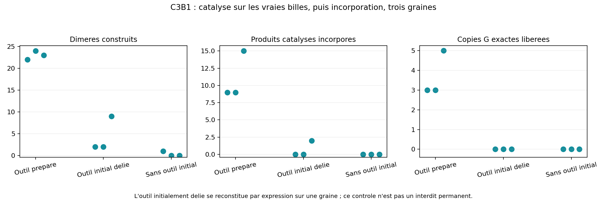
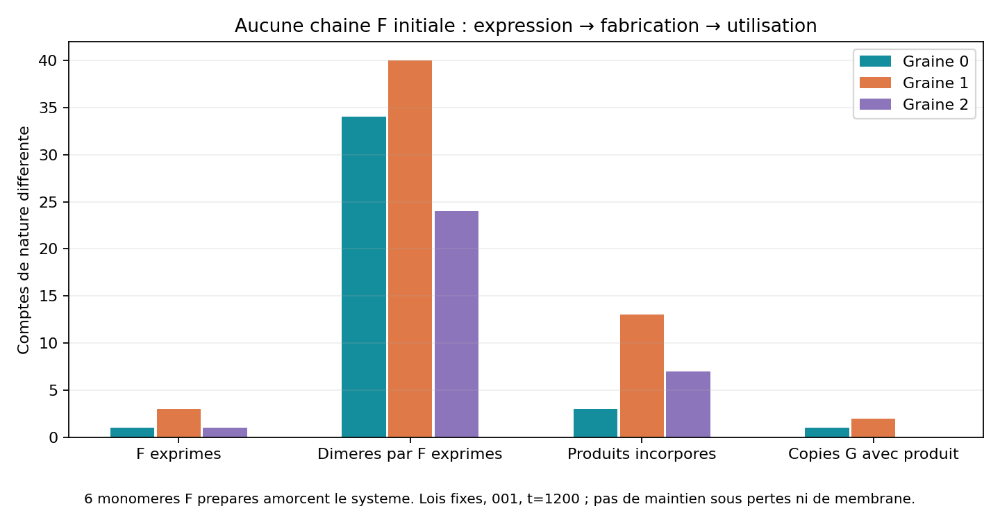

# Lot8 — expression, fabrication de composants et réutilisation

25 octobre2026. **19 dynamiques de recherche achevées, aucune erreur du moteur.**
[Plan](BATCH_08_PLAN.md), [recettes](BATCH_08_RECIPES.json),
[décisions](BATCH_08_DECISIONS.md). Le lot a été interrompu par quota après les
calculs principaux ; reprise des vérifications sans recommencer les expériences.

**Une chaîne F exprimée fabrique de vrais dimères qui sont ensuite incorporés
dans G/F, sous les mêmes lois, sur trois graines.** Des copies G complètes
entièrement constituées de composants fabriqués avec son aide apparaissent
sur deux graines. Une graine produit également deux F complets à partir de
ces composants. Ce sont des renouvellements ponctuels, sans preuve de maintien
sous pertes, de grande capacité génétique ou de membrane commune.

## Lois et coût du candidat C3B1

Le moteur partagé reste inchangé. `precursors.py` porte les captures C2D vers
les vrais précurseurs de `assembly.py`. F0 capte un support P libre (P_G ou
P_F), F1 un reconnaisseur R libre (R0 ou R1). Les deux captures sont saturées.
Si leurs sites F sont voisins directement liés, le P et le R proches forment
leur lien au taux20, contre0,0001 au fond. Rayon de formation0,58. Le produit
garde ses billes et reçoit le symbole de son vrai R. L'occupation du lien retire
son affinité aux précurseurs, libérant les sites.

Le motif catalytique est borné : deux F composites et deux atomes libres, donc
six billes. Il lit une arête directe, jamais une chaîne complète, un gène ou
un nom d'enzyme. Les sites appariés pour templating ne capturent pas de nourriture.
L'activation de capture par un voisin de squelette réutilise C2D et protège
les monomères F. Énergie2/largeur0,6/rayon0,25/taux20/off0,1 réutilisent ses
paramètres. Ressources activées et cycle externe200/15 restent fournis.

Coût ajouté : occupations transitoires site–atome, une table locale F0→P/F1→R,
et une accélération conditionnée par le voisinage covalent avec un taux distinct.
**Ce dernier est un helper chimique explicite**, pas une accélération démontrée
par seule concentration géométrique. L'ablation sans accélération donne zéro
produit dans l'essai testé, malgré des sites occupés. Aucun type élémentaire
supplémentaire ni catalyseur représenté par une bille entière.

`initial_assemblies` déclare les groupes préparés et leur connectivité. Leurs
billes sont prises dans les stocks existants. Les chaînes F initiales sont
exclues des F nouvellement exprimés ; les monomères préparés non liés restent
utilisables. Ce module d'initialisation n'est jamais consulté par les réactions.

## Outil préparé : transfert vers la copie

G001 et F001 préparés,24 supports G et leurs R libres, boîte8×6, température0,6,
durée800, dt0,005 ; résultats graines0/1/2 :

| Condition | Dimères construits | Produits catalysés incorporés | Copies G exactes libérées |
| --- | --- | --- | --- |
| F001 préparé | 22/24/23 | 9/9/15 | 3/3/5 |
| Mêmes F initialement déliés | 2/2/9 | 0/0/2 | 0/0/0 |
| Aucun F préparé | 1/0/0 | 0/0/0 | 0/0/0 |



Dans la première ligne, le même outil préparé réalise22/24/23 opérations.
Toutes les nouvelles copies G utilisent exclusivement les dimères construits ;
aucun partenaire P–R n'était fixé pour ces ressources initiales.

Le contrôle délié **n'est pas un interdit permanent** : sa graine2 réexprime
un F complet à partir des monomères, puis fabrique neuf dimères dont deux sont
incorporés. Ne pas le réétiqueter en contrôle entièrement négatif. L'essai
supplémentaire délié sans ligation du squelette empêche cette reconstitution :
un dimère spontané et aucune opération catalysée, graine0. Sans capture ou sans
accélération locale, graine0 : aucun dimère. Les stocks du contrôle sans outil
incluent les trois supports F/R rendus libres ; le contrôle délié garde mieux
la matière initiale, la géométrie et les rungs du cas préparé.

## Sans chaîne F initiale : expression → catalyse → incorporation

G001,24 supports G,24 supports F et leurs R. **Six monomères F préparés**
amorcent l'expression ; tous les autres P/R sont libres. Aucune chaîne F ni
copie G complète nouvelle au départ. Même chimie, durée1200 :

| Mesure | Graine0 | Graine1 | Graine2 |
| --- | ---: | ---: | ---: |
| F exacts exprimés et libérés | 1 | 3 | 1 |
| Dimères fabriqués par F exprimés certifiés | 34 | 40 | 24 |
| Maximum d'opérations par un même F exprimé | 34 | 26 | 24 |
| Ces produits réellement incorporés | 3 | 13 | 7 |
| Copies G entièrement faites de ces produits, libérées | 1 | 2 | 0 |
| F entièrement faits de ces produits, libérés | 0 | 2 | 0 |



La graine2 a40 formations soutenues au total, dont16 par des motifs non
attribuables à un F exact exprimé auparavant ; elles ne sont pas ajoutées aux24.
Le fond produit aussi4/0/1 dimères. Les comptes ne supposent pas que toute
réaction près d'un polymère soit une opération d'un outil complet.

Premiers F détachés échantillonnés :385,5/185,5/385,5. Premières opérations
certifiées :387,275/198,05/400,15. Premières incorporations de leurs produits :
1055,8/277,825/480,55. La provenance de l'outil doit être établie **avant**
l'opération. Sans gène polymérisé, graine0 t800 : aucun F, aucune opération
catalysée ; un dimère spontané. Les démarrages ne sont pas comparés comme des
rendements à exposition égale lorsque les durées diffèrent.

La graine2 incorpore trois produits dans des fragments G et quatre dans des
fragments F sans achever de copie G. La fabrication n'est donc plus le seul
goulot ; longueur, concurrence et fragments T9 restent ouverts. Trois graines
pour001 ne donnent pas un rendement général ni une bibliothèque fonctionnelle.

## Contrôles, audit et reproduction

- Les deux références C3A001 et E3C001 actif retrouvent **toutes les métriques
  et tous les tableaux exacts** avec la nouvelle branche désactivée.
- Le rapport indépendant vérifie437 empreintes et29 858 images : permanence des
  billes, saturation des rungs, vrais symboles, naissance du composant avant
  incorporation, arête F locale antérieure et produits exacts détachés.
- Le traceur réexécute la graine1 avec les sources archivées et lit les deux
  captures juste avant leur libération :40 réactions locales validées, même
  métrique et mêmes positions/rungs. Il ne modifie ni lois, ni force, ni RNG.
- Reconstruction source seule de la graine0 : toutes métriques et tous tableaux
  identiques. Les archives de source et anciennes recettes restent intactes.
- 51 tests passent :44 moteur/chimies/audit et7 contrôles historiques. Ils incluent
  gradient et conservation du couple, saturation, exclusion du templating,
  arbre/exhaustif, reprise et absence d'attribution rétroactive à un outil.

La validation a révélé un défaut du comparateur de rejeu : les clés d'IDs
numériques sont des chaînes après lecture JSON ; trier avant cette conversion
peut donner un ordre différent. La comparaison normalise désormais les valeurs.
Un rejeu comportant des IDs à un et deux chiffres couvre le défaut. La première
assertion du traceur échouait sur cette comparaison, pas sur les lois ; sa
version d'analyse est conservée dans les sorties locales. Les anciennes sources
ne sont pas corrigées rétroactivement ; la reconstruction source seule fonctionne.

```powershell
python experiments/run_batch8.py C3Bexpress --seed 1 --duration 1200
python experiments/audit_precursor_trace.py research/engine_runs/C3Bexpress_s1_20261025T094654876859Z
python scripts/reconstruct_experiment.py research/engine_runs/C3Bexpress_s0_20261025T094443074138Z
```

Le démonstrateur12 choisit la graine1 pour montrer le renouvellement ponctuel
des F et les copies G. Ce choix illustratif ne remplace pas les trois graines.
Les captures sur les vrais atomes sont affichées en direct et en relecture.

## Décision, architecture et santé

Conserver C3B1 comme référence de fabrication utile : expression→composant→G
passe jusqu'au produit complet sur deux graines, avec incorporation sur trois.
Il s'agit d'une chimie commune pour cette boucle courte, pas d'une addition de
modèles séparés. La membrane reste séparée ; le réseau à trois synthétases et
sa sélectivité ne sont pas réalisés. Aucune perte ni alimentation renouvelée
n'est imposée : les stocks finis ne prouvent pas une maintenance cellulaire.

Les quatre précurseurs P_G/P_F/R0/R1 sont une nourriture spécialisée. L'outil
polyvalent assemble G et F ; il ne démontre pas la distinction de deux états
de même composition depuis X/Y/Z. **X/Y/Z et des N/A isomasses sont des choix
du candidat C0B, pas des exigences de l'utilisateur.** Comparer le coût d'un
alphabet à quatre précurseurs réutilisables et d'un assembleur polyvalent à celui
du schéma XYZ ; ne pas imposer une conversion inutile, ni déclarer l'univers
commun avant d'y construire une membrane renouvelable.

Prochaine décision recommandée : M1, grande frontière préparée, échange et
insertion depuis l'intérieur, pour réduire le risque aval identifié au lot7.
Préserver C3B1 puis revenir à I0/choix d'alphabet et T9/multigène. Le stockage
dense des graphes observés devra devenir parcimonieux avant un bain de milliers
de billes ; les campagnes volumineuses peuvent déjà désactiver la trajectoire.
Poursuite justifiée avec un transfert concret et un coût local déclaré ; aucune
prévision fiable de nombre de lots avant les risques de membrane et de longueur.
