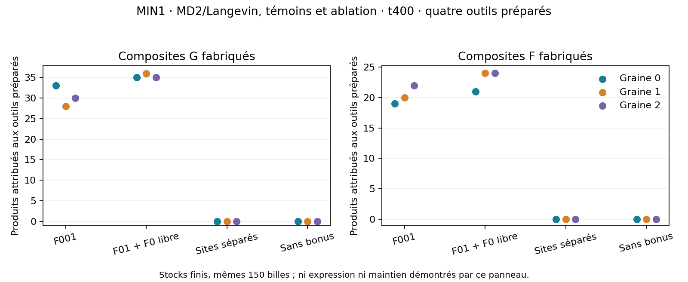

# Lot32 — assembleur minimal et voie qualitative vers L

31 octobre2026. [Plan prospectif](BATCH_32_PLAN.md), [recettes](BATCH_32_RECIPES.json),
[checklist](CELL_CHECKLIST_COMPACT.md), [draft de construction L](LIPID_CONSTRUCTION_DRAFT.md).
Simplification de l'assembleur existant, puis transfert expression→produit.
Aucun nouveau type, loi, taux, port ou outil biologique ajouté au candidat MD2.
La membrane et le moteur ne changent pas ; les démos restent inchangées.

**Clôture :21/21 terminés, zéro erreur.** B ne passe pas les critères annoncés :
expression utile1/3 pour01,1/3 pour001, aucune réincorporation F issue d'un F
exprimé. Contrôles sans gène négatifs3/3. Aucun F entièrement refait depuis
les précurseurs libres. Voir [diagnostic et tableau final](BATCH_33.md) et
[test de renouvellement depuis un départ construit](BATCH_34.md). Les lectures
partielles conservées plus bas ne constituent pas le bilan final.

## Pourquoi ce choix après RV1

La diversité I0/L est le plus grand risque conceptuel. Le mécanisme actuel
recrute P et R par deux sites F voisins, mais l'outil utilisé était F001.
Avant de créer une autre fonction, mesurer si la troisième unité aide réellement
ce motif. Un outil plus court peut être plus facile à reconstruire ; cela
ne remplace pas la capacité future à copier de longues séquences. Ce sont des
contrôles de taille de la fonction P/R existante, pas une nouvelle enzyme
spécialisée nécessitant un nouveau gène. L'extension vers L est seulement dessinée.

## A — outil construit :12 essais achevés, zéro erreur

T0,08, Langevin m1/gamma0,1, dt0,002, réaction0,01, t400,150 billes en12×9.
Quatre outils par essai, même composition de douze F8×0/4×1 et mêmes60 P/R
libres. Aucun squelette G, donc aucune expression dans cette cohorte.
Les variantes long/short/split changent seulement leur connectivité et pose
initiales ; no_boost est l'ablation déclarée du taux catalytique.

| Mesure, graines0 /1 /2 | F001 | F01 + F0 libre | Sites séparés | Sans bonus |
| --- | --- | --- | --- | --- |
| Produits attribués aux outils préparés | 52 /48 /52 | 56 /60 /59 | 0 /0 /0 | 0 /0 /0 |
| Maximum d'opérations du même outil | 15 /18 /18 | 21 /19 /30 | 0 /0 /0 | 0 /0 /0 |

Chaque graine short fabrique G et F ; les sites ne sont pas consommés. Le motif
de deux F, quatre billes, suffit dans ce domaine. Le motif réactif complet
inclut aussi les deux précurseurs : six billes, helper explicite20 vs fond0,0001.
Le contrôle sans bonus montre que sa contribution demeure nécessaire dans
l'horizon testé. Aucun événement ne signifie pas impossibilité : censure t400.



Le total médian59 vs52 n'est pas un rendement stationnaire : les stocks libres
plafonnent à60 nouveaux composites et sont presque épuisés avec short.
Pas de preuve d'optimalité ou de cinétique universelle. Le coût du squelette de
l'outil passe de trois à deux unités ; son gène possible passe de trois à deux
symboles dans le transfert1:1 actuel. **Cela ne prédit pas la taille des autres
outils/gènes**, ni même l'expression du court avant lecture de B.

La porte prospective passe tous ses critères, après A complète. Le superviseur
lance les9 suivis B automatiquement, sans intervention ni nouveau réglage.

## B — gène court, expression et usage, cohorte en cours

Trois graines × gène01, référence001, contrôle01 dépolymérisé ; t1200.
Quatre G construits, six F monomères001011, aucune chaîne F initiale. Même
alphabet, forces, taux, température/cycle et thermostat que A. Le nombre total
reste150 billes ; la préparation génétique diffère intentionnellement :

| Préparation | Supports G / F | Symboles G0 / G1 | Symboles F0 / F1 | Composites préparés |
| --- | --- | --- | --- | --- |
| 01 / sans gène | 39 /36 | 20 /19 | 18 /18 | 14 |
| 001 | 39 /36 | 21 /18 | 18 /18 | 18 |

01 et son témoin sans gène ont mêmes positions initiales, symboles, atomes et
PRNG ; seules les arêtes G sont retirées. La comparaison01/001 n'est donc pas
un effet de longueur toutes choses parfaitement égales, mais un test de deux
architectures minimales explicitement décrites. Ne pas cacher ces différences.

Critère annoncé : au moins2/3 graines short expriment F, puis ses vrais produits
sont incorporés ; au moins2/3 réincorporent des produits G **et** F issus de F
exprimés. Le témoin dépolymérisé doit rester sans F ni catalyse. Comparer toute
la référence001, pas une graine choisie. L'incorporation à un squelette n'est
pas automatiquement une nouvelle chaîne fonctionnelle ou un cycle fermé.

Première lecture partielle, graine0 : short donne un G nouveau et un F nouveau
libérés ; un F exprimé réalise34 opérations, dont deux produits G sont incorporés
et aucun produit F. Référence001 :0 G/0 F nouveaux et0 produit de F exprimé.
Le transfert existe dans cet essai court, mais pas encore sa fermeture vers F.
Une graine ne préjuge pas de la comparaison finale ni des contrôles négatifs.

Lecture suivante4/9 terminés : short graine1 ne produit aucun F nouveau à1200 ;
le témoin sans gène graine0 reste négatif. Donc la réussite préparée3/3 ne
devient pas une expression robuste par simple raccourcissement. B teste en
plus un amorçage **sans outil F initial** ; son échec ne suffirait pas à rejeter
le maintien d'une cellule initialement équipée, qui est autorisée. Une telle
cellule devrait néanmoins refaire son outil : ne pas remplacer cette preuve
par la survie de l'enzyme de départ. Ne pas modifier B après cette lecture.

## Code d'analyse et vérifications

`tool_product_flux.py` relit les événements P/R existants et distingue produits
G0/G1/F0/F1, origine préparée/exprimée/non attribuée/fond, répétitions par outil
et usage réel en aval. Les vrais IDs/symboles R et l'ordre naissance→usage
sont vérifiés ; doubles naissances et application à RV1 sont refusées. Aucun
enregistrement de positions supplémentaire, aucun label dans les réactions.
Les lois et les observateurs du simulateur sont inchangés octet pour octet.

Cinq tests MIN1 passent : inventaires et lois A, appariement strict du témoin B,
jonction réelle par F01 dans un contrôle idéal explicite, provenance/chronologie
et refus d'entrée incompatible, portes de comparaison/usage/contrôle négatif.
Les contrôles ciblés campagne, anciennes portes et checklist passent :31 tests.
Pas de relance complète de toutes les anciennes chimies sans modification du
moteur. La figure générée a été inspectée, ses ablations sont affichées.

Budget21 tâches, deux travailleurs,24h, checkpoints30s, sources A/B et du
superviseur figées avant A. Pas de nouveau scheduler, retry scientifique,
balayage de taux ou promotion automatique. Le commit452f745 conserve les
sources/configurations/recettes ; données brutes dans outputs seulement.

```powershell
minimal_tool_status.bat
python experiments/review_minimal_tools.py
stop_minimal_tool.bat
resume_minimal_tool.bat
```

`start_minimal_tool.bat` crée une **nouvelle** campagne et refuse d'en doubler
une active ; ne pas l'utiliser pour consulter. Une fois B complet, le rapport
calcule ses critères, puis on interprète. Aucune troisième phase automatique.

## L — un draft précis, aucune nouvelle production revendiquée

La voie la plus économique à tester réemploierait le co-recruteur large pour
H/T libres, avec compatibilités élémentaires et activation des ports du vrai
lien H–T. Six types matériels existants, aucun EL/gène ajouté dans cette voie
proposée ; capture des mauvais couples, état libre/lié, énergie et adaptation
des queues n+i sont des coûts et contre-tests explicites. Le produit devrait
fonctionner immédiatement avec les contacts MD2, sans conversion d'observateur.
Ce n'est pas C0B/XYZ déjà réalisé ni un contrat d'implémentation accepté.

Une pince H/T spécialisée reste une alternative à proposer avec gène/renouvellement
et accord utilisateur ; aucune nouvelle machine ne se glisse dans ce lot.
La richesse des fonctions et l'unification matérielle restent ouvertes.

## Maturité et suite

Progrès établi : taille fonctionnelle P/R réduite à deux unités dans un test
séparé sous lois MD2. Pas de nouveau score de diversité, de maintien ou de
fabrication L. La preuve historique de F-03 reste75% sur son domaine ; la
preuve MIN1 A est séparée, sans membrane ni nouveau F exprimé. Les essais B
doivent décider du transfert avant toute adoption dans les démos. Lire leurs
produits réellement utilisés et non uniquement leurs compteurs de catalyse.

Après B : si le court transfère, l'essai aval est le bain commun et la voie L
avec son coût annoncé ; sinon diagnostic de l'expression/géométrie sous mêmes
lois avant de changer la chimie. Copie riche, protection/recyclage RV1 et
homéostasie restent des risques distincts, jamais résolus par un gène plus court.
