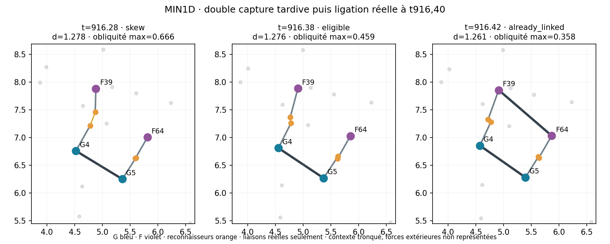

# Lot33 — clôture MIN1 et diagnostic moléculaire passif

[Plan](BATCH_33_PLAN.md) · [recettes](BATCH_33_RECIPES.json) ·
[suite de renouvellement](BATCH_34.md).

## MIN1 est achevé,21/21 sans erreur

A conserve son résultat : outil F01 préparé actif3/3 sous MD2, comme fonction
P/R plus courte que F001. B ne passe pas les critères prospectifs :

| B, graines0 /1 /2 | G nouveaux | F nouveaux | Produits par F exprimé | Produits G / F réincorporés |
| --- | --- | --- | --- | --- |
| 01 | 1 /0 /0 | 1 /0 /0 | 34 /0 /0 | 2/0 ·0/0 ·0/0 |
| 001 | 0 /0 /2 | 0 /0 /2 | 0 /0 /6 | 0/0 ·0/0 ·1/0 |
| Sans gène01 | 0 /0 /0 | 0 /0 /0 | 0 /0 /0 | 0/0 ·0/0 ·0/0 |

Aucun F entièrement refait depuis les précurseurs libres dans les neuf essais B.
L'activité d'un F produit depuis des monomères préparés n'est pas le renouvellement
matériel de l'outil. Le gène court ne résout pas à lui seul l'amorçage ; aucun
succès intégré, score global ou promotion dans les démos n'est déduit de MIN1.
Les critères et témoins restent inchangés, les échecs conservés.

## Diagnostic choisi : double capture ou géométrie ?

Inspection finale des neuf checkpoints sous leurs sources archivées : normales
voisines G presque parallèles. Cela ne démontre pas l'histoire des contacts.
Deux rejeux **sélectionnés** du court, graine0 positive et1 négative, reprennent
exactement leurs scénarios, horizon1200 et PRNG avec GKA et une loupe.

Résultat essentiel : positions, vitesses, liaisons, angles, chimie, cache de
mouvement, PRNG et toutes métriques primaires sont exactement identiques aux
originaux. Les seules différences de sources admises concernent l'observation
et son branchement au travailleur ; toute autre différence est refusée par la revue.
Ce sont des diagnostics des mêmes trajectoires, pas des répétitions indépendantes.

| Exposition pré-tick en temps-arête | Graine0 | Graine1 |
| --- | ---: | ---: |
| Une seule capture F sur l'arête G | 1343,79 | 1789,61 |
| Deux F non encore liés | 0,13 | 0 |
| Deux F, géométrie de ligation admissible | 0,04 | 0 |
| Deux F, rejet pour obliquité | 0,09 | 0 |

La graine0 attend t916,28 pour le premier double motif observé ; obliquité
admissible à916,37, liaison effective à916,40. La graine1 ne présente aucun
double motif F pré-tick jusqu'à1200. Cela oriente vers l'obtention de la seconde
capture, pas vers une correction urgente de ligation après double capture.
Ne pas généraliser cette causalité à toutes les graines ni toutes les chimies.
Les expositions sont approximatives avant réaction, pas des hazards exacts ;
les changements dans un même tick peuvent être manqués.



## Outil de loupe durable, activation temporaire

`LigationLoupe` choisit uniquement pour observer les deux premiers motifs F
distincts visibles avant réaction. Fenêtre1, cadence0,02, rayon1,5,24 billes et
128 enregistrements maximum, états sauvegardés/repris. La graine0 a51 images
locales et un événement ; la graine1 zéro image faute de cible. Le budget ne
provoque aucune particule/capture et ne pilote pas la chimie. Les influences
extérieures et le voisinage tronqué restent déclarés.

L'option `ligation_loupe` exige un audit génétique et un scénario copy ; elle
est absente des démos et des autres campagnes. Les caches de voisinage et le
PRNG du moteur ne sont pas consultés/modifiés. Les captures restent locales
dans outputs, les recettes et une figure de synthèse sont versionnées.
La planche code-générée a été inspectée. Aucun nouveau rendu ou replay GUI
avancé n'est ajouté sous prétexte de diagnostic.

Quatre tests de loupe : géométrie et budget, pas de capture sans cible,
passivité/reprise exacte, validation du protocole. Suite complète182 tests
passée hors sandbox ; les refus de fichiers temporaires du sandbox sont
techniques et n'ont entraîné aucune correction de chimie. Trois préfixes MD2
t5 encore exactement conservés et catalogue21 choix recertifié ; pas de démo
ou loi modifiée. Sources et recettes dans le commit8cbba6d, aucun push.

```powershell
minimal_diagnostic_status.bat
python experiments/review_minimal_diagnostic.py
python experiments/render_minimal_loupe.py
```

## Décision scientifique et suite

MIN1 part sans F polymérisé. La cible autorise une cellule déjà construite ;
le bon test de maintien peut partir d'un outil, à condition de mesurer son
remplacement complet depuis les vrais précurseurs et l'activité du remplaçant.
Cela motive MIN1R, nouveau plan explicite après la clôture de ce diagnostic,
pas une troisième phase glissée dans MIN1 ou un assouplissement de sa porte.
Aucune modification de taux, de mélange ou de garde n'est justifiée ici.

La preuve générale de renouvellement reste ouverte tant que MIN1R n'est pas
lu. Nouvelle entrée T-05 pour distinguer le renouvellement matériel du
co-recruteur actuel de T-04, qui concerne tous les outils de la cellule cible.
L, information riche, transport ouvert et homéostasie restent des verrous
distincts ; la précision du diagnostic n'est pas une hausse de maturité biologique.
