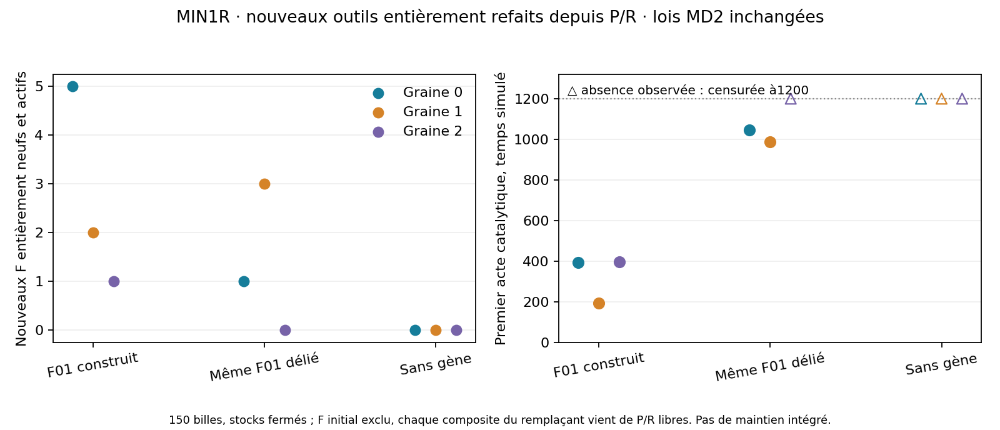

# Lot34 — MIN1R, construction de nouveaux catalyseurs depuis la nourriture

[Plan prospectif](BATCH_34_PLAN.md) · [recettes](BATCH_34_RECIPES.json) ·
[diagnostic précédent](BATCH_33.md) · [checklist](CELL_CHECKLIST_COMPACT.md).

**Clôture :9/9 terminés, zéro erreur, aucun calcul actif. Critères prospectifs
passés.** Trois graines active refont des F entiers depuis les précurseurs
libres puis ces remplaçants travaillent. Ce n'est pas une preuve de maintien
avec membrane, pertes ou alimentation ouverte. Les lectures partielles sont
conservées plus bas comme historique.

L'enzyme initiale n'est pas détruite dans ce protocole. Le résultat établit
la **production de remplaçants fonctionnels**, pas un remplacement effectivement
nécessaire sous pertes, ni un temps de demi-renouvellement de la population.

Après MIN1 et ses deux rejeux, tester le départ construit autorisé par l'objectif,
sans changer les lois. Un seul F01 est lié parmi les six F composites initiaux ;
les deux témoins conservent exactement les mêmes positions, symboles, PRNG
et150 billes. Split retire seulement ce lien ; nogene retire les liens G.
Quatre G01 construits, quatre autres F monomères, stocks P/R finis. Aucun
outil biologique, gène, élément, taux ou port additionnel. MD2/Langevin inchangé.

## Mesurer un remplaçant, pas la persistance de l'ancien

Le census exclut le F initial des nouveaux exprimés. Pour compter un outil
entièrement refait, tous ses composites doivent avoir été formés depuis P/R
libres ; pour compter son activité, il doit avoir été observé exprimé et libéré
**avant** l'opération, avec toutes ces naissances antérieures. Les IDs des vrais
atomes, les symboles et les temps de produits sont conservés. Réutilisation des
IDs après dégradation n'est pas admise dans cet analyseur : RV1 est absent.

`review_renewal.py` calcule nouveaux F, F entièrement neufs libérés, F entièrement
neufs actifs, nombre de leurs opérations et première activité, avec routes G/F
des produits. Un squelette quelconque, des monomères préparés ou l'ancien F
qui travaille encore ne satisfont pas ce critère. Les seuils2/3 et contrôles
négatifs sont préfixés dans le plan et calculés, pas jugés à l'œil.

## Campagne et premières données

Neuf essais, trois graines ×active/split/nogene, t1200, deux travailleurs,
checkpoints30s. Sources et configurations figées ; pas de suivis automatiques
ni de nouveau réglage. Les diagnostics33 étaient achevés avant lancement.

Première lecture2/9, sans erreur :

| Graine0 | F nouveaux libérés | Entièrement refaits depuis P/R libres | Dont actifs ensuite | Opérations de ces nouveaux outils |
| --- | ---: | ---: | ---: | ---: |
| F01 initial actif | 11 | 10 | 5 | 12 |
| Même F01 délié | 6 | 3 | 1 | 1 |

Première activité d'un F entièrement nouveau :392,68 contre1045,97. Le témoin
délié peut donc aussi amorcer une reconstruction ; ne pas le requalifier en
interdit permanent. Les deux cas partagent une préparation spatiale corrélée
des deux F01, différente des six monomères séparés de MIN1 B. Les comparer
directement à l'ancienne préparation ne mesure pas un pur effet de lien.

Ces données montrent un renouvellement ponctuel du même petit outil dans une
graine. La porte de cohorte reste **non évaluée** tant que les neuf essais ne
sont pas terminés ; aucune robustesse ni nécessité du F initial ne découle
de ces deux résultats. Lire aussi les contrôles sans gène et tous les split.
Pas de membrane, perte volontaire, flux ouvert ou régime stationnaire ici.

Lecture suivante4/9 : le contrôle sans gène graine0 donne zéro G/F nouveau ;
active graine1 donne12 G et13 F nouveaux, dont10 F entièrement refaits et2
actifs ensuite. Deux graines active satisfont donc déjà les critères matériels,
mais la décision de cohorte attend les neuf essais et les autres témoins.

## Bilan final, graines0 /1 /2

| Condition | G nouveaux | F nouveaux | F entièrement refaits | Dont actifs ensuite | Leurs opérations |
| --- | --- | --- | --- | --- | --- |
| active | 9 /12 /8 | 11 /13 /12 | 10 /10 /10 | 5 /2 /1 | 12 /9 /9 |
| split | 9 /5 /0 | 6 /7 /1 | 3 /5 /0 | 1 /3 /0 | 1 /9 /0 |
| nogene | 0 /0 /0 | 0 /0 /0 | 0 /0 /0 | 0 /0 /0 | 0 /0 /0 |

Première activité des remplaçants entièrement neufs : active392,68/192,14/395,92 ;
split1045,97/987,04/censuré1200. Le départ avec outil réussit3/3, le délié2/3 ;
ce sont trois paires de trajectoires, pas un estimateur universel d'accélération.
Les trois contrôles sans gène sont négatifs. La nécessité du F initial n'est
pas établie : sa construction aide dans ce domaine, elle n'est pas obligatoire.



L'analyse vérifie un cycle utile sous lois communes : co-recrutement→composites
F réellement fabriqués→expression G→F entier libéré→nouvelle catalyse. Les
monomères du départ et l'enzyme initiale ne sont pas comptés comme remplaçants
entièrement neufs. Le nombre d'opérations est un cumul d'événements, pas autant
de protéines ou de générations. Aucun nouvel alphabet ou bonus par fonction.

T-05 passe au palier50% « testé séparément », T-03 au couplage limité75%, T-01
à50% pour la courte expression. Pas100% : aucun transfert avec membrane/pertes,
capacité informationnelle générale ou maintien de tous les outils. Les stocks
finis bornent les populations par épuisement ; H reste0 et L reste non fabriqué.

## Validation et consultation

Trois tests supplémentaires passent : égalité exacte des états initiaux hors
liens, exclusion du F préparé, activité entièrement nouvelle exigeant chaque
composite et sa naissance antérieure, porte exigeant deux graines et nogene
négatif. La suite complète du lot33 avait182 tests, ces trois sont additionnels.
Les données brutes, reprises et journaux restent dans outputs, seules recettes,
code et conclusions sont versionnés. Commit de campagne d5a00d7, aucun push.

```powershell
renewal_status.bat
python experiments/review_renewal.py
stop_renewal.bat
resume_renewal.bat
```

`start_renewal.bat` crée un nouveau dossier et refuse d'en doubler un actif.
Les campagnes peuvent continuer après la réponse tant que la machine reste
active. Reprise explicite après arrêt ; aucune relance d'essai en erreur.

Maturité : construction complète de nouveaux outils actifs3/3, plus forte que
la seule expression depuis des monomères fournis. Pas encore entretien sous
pertes ou renouvellement de tous les outils du projet. Prochain test : transfert
dans le bain avec membrane ; pas une grande grille de taux. L, information riche,
recyclage/protection et homéostasie restent ouverts et inchangés.
