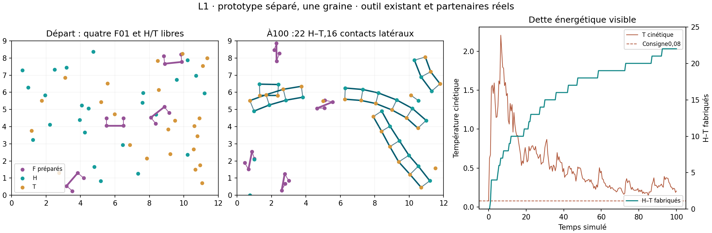

# Lot36 — une voie matérielle H/T→L implémentée et un premier pilote

4 novembre2026. [Plan](BATCH_36_PLAN.md) · [recette exacte](BATCH_36_RECIPES.json).
Travail indépendant de MIN1M, qui poursuit sa campagne avec ses sources figées.

## Avance fonctionnelle

Le nouveau hook opt-in `lipid_synthesis` utilise Simulation, le co-recruteur
F01 déjà présent et les noyaux MD2. H/T initialement libres se lient à deux
sites F voisins ; formation d'un vrai lien saturé, libération des sites et
activation des ports latéraux. Aucun L n'est créé en remplaçant des atomes,
aucune pose ajustée à sa formation, aucune protéine supplémentaire.

`LinkedLipids` retire la contrainte queue=n+tête : vrais IDs H/T, vue compacte
des seuls liens existants, redistribution exacte des forces, contacts latéraux
et échange conservés par tête. Le mécanisme inspecte seulement les liens axiaux,
leurs ports et deux ligands proches ; la vue globale est un index de calcul,
pas une reconnaissance de membrane ou de fonction biologique.

Extension chimique **L1 séparée**, pas promotion MD2 : nouvelles classes de
ligands H/T pour la même pince, activation locale de ports et contacts au lien.
Constants de capture et formation réutilisées, zéro type matériel/outil/gène
supplémentaire. La bibliothèque Python réutilisée ne prouve pas une chimie
commune : le pool ne contient pas P/R, gènes ou expression. La cible XYZ/C0B
à trois synthèses n'est pas remplacée silencieusement par cette variante.

## Un pilote dispersé, pas une cohorte de validation

Graine0, t100,64 billes : quatre F01 construits,24 H et24 T indépendants,
aucun H–T ou lien latéral initial. Langevin1/0,1, consigne0,08, dt0,002,
captures et taux identiques aux valeurs du plan. Calcul21,84s, terminé sans
erreur. **22 H–T formés, tous attribués à deux sites liés ; maximum8 produits
sur une même paire de sites.**21 des22 queues diffèrent du partenaire n+i.
Les64 atomes sont conservés, chaque H et T utilisé une fois au plus.

Les produits prennent réellement part à l'association MD2, sans changement de
lois entre fabrication et usage :16 contacts latéraux au terme, premier contact
échantillonné à13,5. Cela ne prouve ni vésicule fermée, ni insertion dans une
frontière cellulaire, ni renouvellement de celle-ci. L'outil reste préparé.

**Dette énergétique mesurée** : température cinétique finale0,205 ; moyenne du
dernier quart0,251 contre consigne0,08. Ne pas présenter ces températures comme
équivalentes : capture/liaison/activation des ports sont des aides non calibrées.
Le pilote n'établit pas un taux isotherme ou une amélioration de la catalyse
dans MD2. Pas de nouveau réglage thermique pour masquer ce constat.

La recette conserve sources et scénario exacts. Résultats, checkpoints et
audit détaillé restent dans outputs/lipid_pilots. Aucun contrôle négatif dispersé
ou autre graine ajouté après lecture : le budget du plan est respecté. Les
contacts imposés et taux forcés des tests logiciels sont séparés du pilote.

## Vérifications et limites

Six nouveaux tests : forces/énergie exactement celles de MD2 à ID standard,
gradients numériques et force nette, permutation avec spectateurs, réactions de
ports/PRNG et restauration, partenaires croisés et saturation, libération/réemploi
sur contacts contrôlés, bonus refusé sans lien entre sites, tree/brute, passivité,
checkpoint exact et absence d'outil. Suite complète :195 tests passent.

Trois préfixes MD2 de cinq unités restent bit-exacts : positions, liens,
PRNG, vitesses et caches. Les presets actuels ont été recertifiés après ajout
du hook au registre ; aucune démo L1 introduite ni chimie MD2 modifiée.

S-04 passe0→25% pour ce **sous-cas L1 séparé**, pas pour MD2 ou la cellule.
F-02 reste0 : élargir les substrats du même motif ne prouve pas un répertoire
de fonctions programmables. Énergie, compétition P/R/H/T, expression de l'outil
dans ce bain, insertion, pertes et homéostasie restent à vérifier.

## Prochaine décision

Lire MIN1M complet avant d'ajouter une campagne longue. Préparer ensuite un
protocole L1 avec témoins no_tool/split/no_boost, plusieurs graines et bilan
thermique ; distinguer contacts rares, saturation, attente et produits instables.
Puis cohabitation P/R/H/T et vraie insertion des produits. Le point thermique
peut demander un bilan de transitions locales plutôt qu'un ralentissement de
la diffusion. Si la pince polyvalente s'empoisonne, comparer la représentation
ou proposer une machine sélective avec gène/renouvellement avant implémentation.

## Loupe énergétique motivée : première formation à0,86

Pour expliquer l'échauffement, un rejeu s'arrête après une unité de temps et
enregistre une seule transition, six billes locales. Le calcul d'énergie inclut
les64 billes pour ne pas perdre les contacts extérieurs. Aucun tirage aléatoire,
cache partagé ou changement de trajectoire : positions, vitesses, PRNG et état
chimique exactement égaux au contrôle non instrumenté jusqu'à1,0.

| Terme affecté au lien | Variation de potentiel |
| --- | ---: |
| Répulsion activée F/L | +22,670 |
| Ressort axial H–T | +10,454 |
| Ressorts de capture retirés | −0,850 |
| Attraction de capture libre | −0,858 |
| Ports latéraux | 0 |
| **Total à positions inchangées** | **+31,416** |

Le produit naît près des sites qui le capturent ; rendre soudain ses contacts
F/L répulsifs et son axe rigide crée donc une forte énergie de potentiel. C'est
une cause concrète identifiée, pas seulement une fluctuation thermique supposée.
Ce saut sélectionné n'est pas un bilan de chaleur sur tout l'essai. Les22 produits
ne doivent pas servir de preuve d'efficacité isotherme à0,08.

Avant une cohorte L1, comparer conceptuellement : contacts de capture compatibles
avec la géométrie finale, transitions de liaison tenant compte du coût énergétique
local, ou activation progressive locale avec coût/helper explicite. Ne pas déplacer
les atomes au moment de réagir, supprimer le thermostat, augmenter arbitrairement
le frottement pour cacher le saut ou introduire une température par fonction.
Ces options ne sont pas encore implémentées ; le code et le pilote L1 restent figés.
