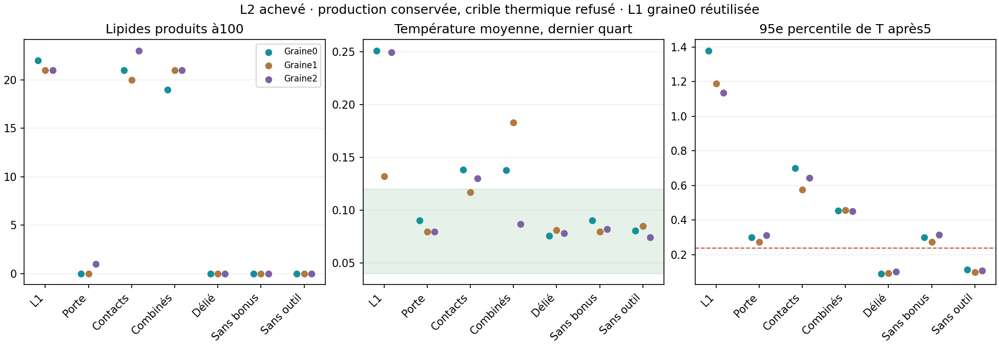

# Lot37 — L2 achevé, production utile mais porte thermique refusée

4 novembre2026. [Plan prospectif](BATCH_37_PLAN.md) · [recettes](BATCH_37_RECIPES.json).
Le quota avait interrompu la rédaction/les commits après lancement.20 nouveaux
essais sont maintenant achevés sans erreur ; référence L1 graine0 réutilisée,
21 cas analysés. Superviseur arrêté pour interprétation, aucune relance automatique.

## Contribution et conformité

La porte énergétique additionne uniquement les potentiels modifiés dans les
voisinages finis des deux atomes et des sites de capture libérés. Son résultat
est contrôlé contre la différence exacte des potentiels complets, mais le
potentiel du bain entier ne pilote pas les réactions. Pas de mesure biologique,
nouvelle protéine, déplacement instantané ou changement de thermostat.
Les contacts compatibles F/L sont une variante locale de superposition, avec
risque aval de rétention à tester avec une vraie barrière membranaire.

Quatre tests de la porte et trois du protocole s'ajoutent : variation exacte,
absence d'effet de spectateurs distants, refus du gros saut sans repositionner,
tree/brute/passivité/checkpoint, comparaisons et seuils, arrêt au budget1h.
La suite complète202 tests passe. Les trois préfixes MD2 restent bit-exacts,
ainsi que le préfixe L1 par défaut ; les démos ont été recertifiées. Aucun L2
promu dans la GUI. Le message du superviseur affiche désormais son budget réel.

## Résultats, graines0 /1 /2

| Variante | L produits | Max produits / paire de sites | Contacts latéraux finaux | T moyenne75–100 | P95 T après5 |
| --- | --- | --- | --- | --- | --- |
| L1 référence | 22 /21 /21 | 8 /9 /8 | 16 /17 /14 | 0,251 /0,132 /0,250 | 1,379 /1,188 /1,135 |
| Porte seule | 0 /0 /1 | 0 /0 /1 | 0 /0 /0 | 0,090 /0,080 /0,079 | 0,300 /0,274 /0,314 |
| Contacts seuls | 21 /20 /23 | 7 /8 /7 | 15 /14 /17 | 0,139 /0,117 /0,130 | 0,701 /0,576 /0,644 |
| Combinés | 19 /21 /21 | 6 /8 /6 | 13 /15 /15 | 0,138 /0,183 /0,087 | 0,456 /0,457 /0,453 |
| Délié | 0 /0 /0 | 0 /0 /0 | 0 /0 /0 | 0,076 /0,081 /0,078 | 0,092 /0,094 /0,102 |
| Sans bonus | 0 /0 /0 | 0 /0 /0 | 0 /0 /0 | 0,090 /0,080 /0,082 | 0,300 /0,274 /0,314 |
| Sans outil | 0 /0 /0 | 0 /0 /0 | 0 /0 /0 | 0,081 /0,085 /0,074 | 0,115 /0,100 /0,108 |

Le combiné passe production utile, association, avantage sur témoins et absence
de fausse attribution. Il **échoue aux deux critères thermiques**, figés à
0,04–0,12 pour la moyenne tardive et≤0,24 pour P95 après5. La porte seule
supprime presque toute production ; refuser la mauvaise géométrie énergétique
ne suffit pas à la rendre constructive. Les contacts seuls réduisent la chaleur
sans la supprimer. Aucun seuil n'est assoupli après coup.

Les temps sans formation restent censurés à100. Stocks finis, trois petites
graines, pas de débit stationnaire, expression, insertion cellulaire ou bilan
thermodynamique complet. S-04 reste25% et Q-01 inchangé : un filtre d'énergie
sur la naissance H–T ne corrige pas toutes les autres transitions du modèle.

## Interprétation et prochain travail

Sans bonus mais avec F liés, l'échauffement transitoire demeure alors qu'aucun
L n'est fabriqué. Il faut séparer énergie élastique de la préparation des F et
sauts de capture/libération, avant toute nouvelle grille. Le candidat suivant
devra réutiliser les taux et la cinétique Langevin, conserver des témoins et
montrer que des produits vrais restent utiles à température commune.
MIN1M continue en parallèle avec ses sources figées ; ses9/12 premiers résultats
ne sont pas une porte complète, même si les deux graines active achevées
refont déjà des F entiers actifs avec membrane.
