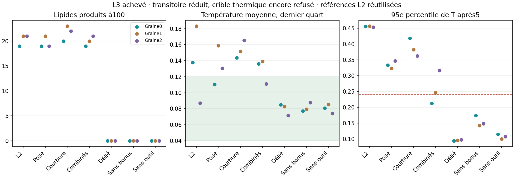

# Lot38 — diagnostic de la capture et comparaison L3

**Clôture :18/18, zéro erreur ; crible thermique refusé, aucun calcul L3 actif.**
Les lectures partielles ci-dessous sont historiques. Un nouveau lot39, trois
suivis sélectionnés à400 sans changement de chimie, sépare refroidissement
encore en cours et échauffement entretenu ; il ne requalifie pas la porte L3.

4 novembre2026. [Plan](BATCH_38_PLAN.md) · [recettes](BATCH_38_RECIPES.json).
L2 clôturé20/20 sans erreur, crible thermique refusé ; aucune relance L2.
MIN1M poursuit ses derniers essais avec les sources de son lancement.

## Causes ciblées au lieu d'un balayage de paramètres

Le témoin L2 sans bonus s'échauffe sans fabriquer de L. Une loupe passive
sur sa première capture à0,01 mesure : ressort+0,224, attraction libre retirée
+2,279, total+2,503 à positions inchangées. Elle révèle également51,2 unités
angulaires stockées dans les quatre outils construits droits. Une transition,
trois atomes enregistrés ; les énergies incluent les64 atomes pour le contexte.
Positions, vitesses, PRNG et chimie égaux au contrôle jusqu'à2. Aucun bilan
intégral de chaleur déduit de cette capture sélectionnée.

Le diagnostic se relance automatiquement avec les sources L2 archivées. Chaque
rejeu écrit un nouveau dossier local ; aucune ancienne preuve écrasée.

## Changements fonctionnels L3, opt-in seulement

- Le départ construit peut placer chaque F01 dans ses longueurs/angles natifs,
  sans relaxation pilotée pendant la simulation. L'énergie élastique initiale
  tombe sous la précision numérique. Supports, nourriture et PRNG conservés ;
  les R préparés changent de position. Split garde exactement cette même pose.
- Le ressort de capture peut reprendre la courbure E/largeur² du potentiel
  gaussien existant :5,556 au lieu de35, sans nouvelle constante indépendante.
  Cette même raideur intervient dans la mécanique, le diagnostic et ΔU local.

Ni taux, température, frottement ni dt modifié. Pas d'outil/gène supplémentaire,
aucun atome déplacé au moment d'une réaction. Le niveau de potentiel à la capture
reste un helper non calibré : force assortie ne veut pas dire énergie continue.
Le repliement des futurs F exprimés n'est pas résolu par la pose initiale native.
L3 reste une chimie H/T séparée ; la capture P/R de MD2 garde encore sa raideur
historique. Un transfert commun devra appliquer et tester les mêmes lois.

## Campagne

18 nouveaux essais t100, trois graines ×pose seule/courbure seule/combinaison/
split/no_boost/no_tool. Trois L2_combined réutilisés comme référence ; préfixe
par défaut exactement égal avant réemploi. Un travailleur, checkpoints30s,
budget1h, analyse automatique puis arrêt, aucun balayage de taux ou retry.
Les six critères de L2, notamment les deux seuils thermiques, sont inchangés.

Première lecture4/18 sans erreur, sélection par ordre d'achèvement, pas cohorte :
pose0 produit19 L (T tardive0,110/P950,334), courbure0 produit20 (0,144/0,418),
combinaison0 produit19 (0,136/0,213), split0 aucun (0,085/0,095). Le transitoire
combiné s'améliore mais sa moyenne tardive dépasse déjà0,12 ; ne pas promouvoir
ni assouplir le seuil. Attendre l'ensemble pour l'interprétation des ablations.
Suivi par **lipid_curvature_status.bat**, pause par **stop_lipid_curvature.bat**.

## Vérifications et maturité

Contrôles de préparation native, raideur dérivée, variation locale d'énergie,
reprise exacte et protocole apparié passent. Préfixes MD2 et L2 inchangés,
catalogue recertifié ; aucune démo expérimentale L3 ajoutée.
La suite complète207 tests passe.
S-04 reste25%, Q-01 inchangé : production réelle mais fermeture thermique et
compatibilité P/R, expression, insertion/rétention encore à établir. Si les
deux corrections ne suffisent pas, réexaminer capture et changements de
potentiel avant une nouvelle valeur de raideur. Ni viabilité ni délai garantis.

## Contexte intégré, lecture10/12 de MIN1M

Les trois cas active achevés refont7/6/2 F entiers depuis P/R, dont6/4/2 actifs
ensuite pour12/6/16 opérations. Fraction parent fermée sur grille régulière :
0,8567/0,8563/0,8526. L'enzyme initiale reste présente ; production de remplaçants
fonctionnels, pas remplacement nécessaire sous pertes. Deux témoins sont encore
en cours, donc aucune décision finale de cohorte ou promotion GUI anticipée.

Pour situer le problème thermique du petit pool, une lecture post-hoc séparée
mesure T moyenne900–1200 :0,08382/0,08351/0,08272 dans ces cas intégrés, consigne
0,08. Cela n'invalide pas l'échec L2 ni ne prouve la compatibilité de L3 ; taille,
réactions et préparation diffèrent. L'analyse ne modifie pas les seuils figés
de MIN1M. Source : `experiments/membrane_thermal_context.py`, audits et hashes
locaux conservés. Les résultats incomplets ne sont pas extrapolés.

## Clôture L3, graines0 /1 /2

| Variante | L produits | Max produits / paire | Contacts latéraux | T75–100 | P95 T après5 |
| --- | --- | --- | --- | --- | --- |
| Référence L2 | 19 /21 /21 | 6 /8 /6 | 13 /15 /15 | 0,138 /0,183 /0,087 | 0,456 /0,457 /0,453 |
| Pose seule | 19 /21 /19 | 7 /7 /9 | 14 /13 /12 | 0,110 /0,159 /0,131 | 0,334 /0,324 /0,347 |
| Courbure seule | 20 /23 /22 | 7 /7 /10 | 15 /18 /15 | 0,144 /0,151 /0,166 | 0,418 /0,383 /0,363 |
| Combinés | 19 /20 /21 | 8 /7 /8 | 10 /14 /14 | 0,136 /0,139 /0,111 | 0,213 /0,247 /0,317 |
| Délié | 0 /0 /0 | 0 /0 /0 | 0 /0 /0 | 0,085 /0,083 /0,071 | 0,095 /0,096 /0,098 |
| Sans bonus | 0 /0 /0 | 0 /0 /0 | 0 /0 /0 | 0,077 /0,080 /0,088 | 0,175 /0,142 /0,149 |
| Sans outil | 0 /0 /0 | 0 /0 /0 | 0 /0 /0 | 0,081 /0,085 /0,074 | 0,115 /0,100 /0,108 |

Les quatre critères fonctionnels passent ; les deux critères thermiques restent
refusés. La combinaison réduit le transitoire mais pas assez sur toutes les
graines, et deux températures tardives dépassent0,12. Pas de promotion ou
nouvelle valeur de raideur. Les témoins confirment une activité liée au motif,
sans prouver une fermeture énergétique.

Diagnostic d'horizon : dernières naissances combinées98,51/77,61/86,35 ; moyennes
T50–75 =0,149/0,173/0,134, puis0,136/0,139/0,111 à75–100. La température décroît
encore et la phase dite tardive reste productive. Il faut donc mesurer sa queue
avant d'attribuer tout l'écart à un régime permanent. [Lot39](BATCH_39_PLAN.md)
préfixé : trois horizons400, mêmes lois, préfixes comparés à L3 et sélection
déclarée ; stocks finis, pas de maintien alimenté ni de révision du crible L3.
