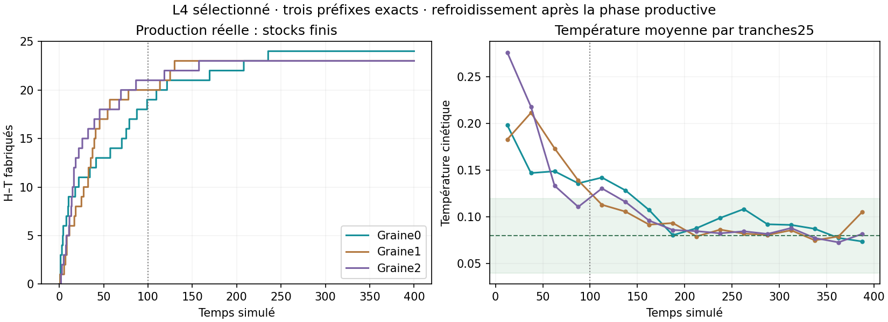

# Lot39 — trois suivis thermiques sélectionnés

**Clôture :3/3, zéro erreur, trois préfixes exacts ; aucun calcul L4 actif.**

4 novembre2026. [Plan](BATCH_39_PLAN.md) · [recettes](BATCH_39_RECIPES.json).
L3 est arrêté après18 essais sans erreur et un crible refusé ; aucun réglage
supplémentaire. Ce lot conserve exactement la chimie combinée et porte les
trois horizons à400 pour observer refroidissement ou échauffement entretenu.

Trois tâches, un travailleur, checkpoints30s, budget1h puis pause ; analyse et
arrêt automatiques sans deuxième phase. Les historiques et événements du
préfixe0–100 ainsi que l'audit thermique doivent égaler exactement ceux de L3.
Ce préfixe n'est pas une nouvelle réplication indépendante. Une queue froide
après stocks finis ne prouve pas le fonctionnement sous nourriture continue.

Lancement validé ; voir **lipid_tail_status.bat**. Les critères de L3 et les
lois/données de MIN1M ne sont pas modifiés. S-04 et Q-01 restent aux mêmes
paliers. Prochaine décision : rapport complet de L4 puis représentation des
transitions/compatibilité commune, plutôt qu'un nouveau balayage de paramètres.

## Résultats sélectionnés, sans révision de L3

| Graine | L à400 | Contacts latéraux | Dernière naissance | T100–200 | T200–300 | T300–400 | T350–400 |
| --- | ---: | ---: | ---: | ---: | ---: | ---: | ---: |
| 0 | 24 | 21 | 235,50 | 0,1145 | 0,0969 | 0,0826 | 0,0758 |
| 1 | 23 | 20 | 129,52 | 0,1010 | 0,0822 | 0,0864 | 0,0923 |
| 2 | 23 | 20 | 157,40 | 0,1071 | 0,0834 | 0,0801 | 0,0773 |

Tous les préfixes d'historiques, naissances et audits thermiques jusqu'à100
égalent exactement L3. Aucune naissance après300. Les trois moyennes350–400
respectent le repère0,04–0,12, et les moyennes300–400 sont proches de0,08.
Dans ces essais fermés, le chauffage observé à100 s'explique donc en partie
par un transitoire productif et une relaxation encore en cours, pas une
instabilité persistante démontrée. La chaleur sous apport continu reste inconnue.

Le crible L3 à100 reste refusé et ces suivis restent sélectionnés, non des
réplications indépendantes. Aucun taux ou thermostat changé. Ce résultat évite
une troisième rustine mécanique prématurée ; prochain jalon utile : transfert
de la capture et des produits sous une vraie chimie commune P/R/H/T, avec
activité/rétention et bilan de puissance sous alimentation à mesurer.
S-04 et Q-01 restent aux mêmes paliers, aucun maintien cellulaire démontré.
