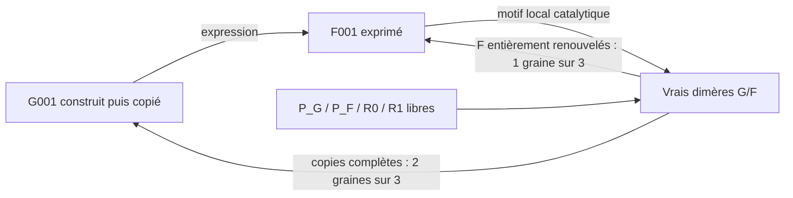
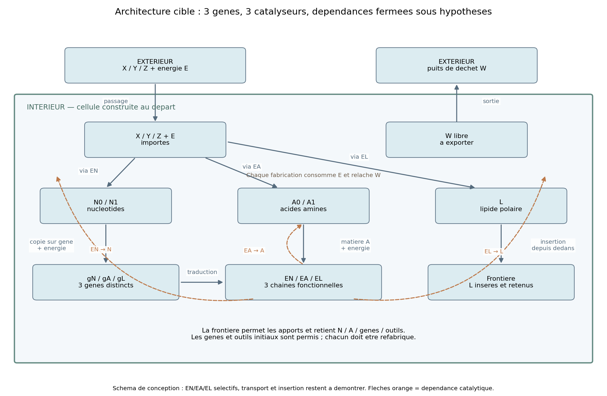
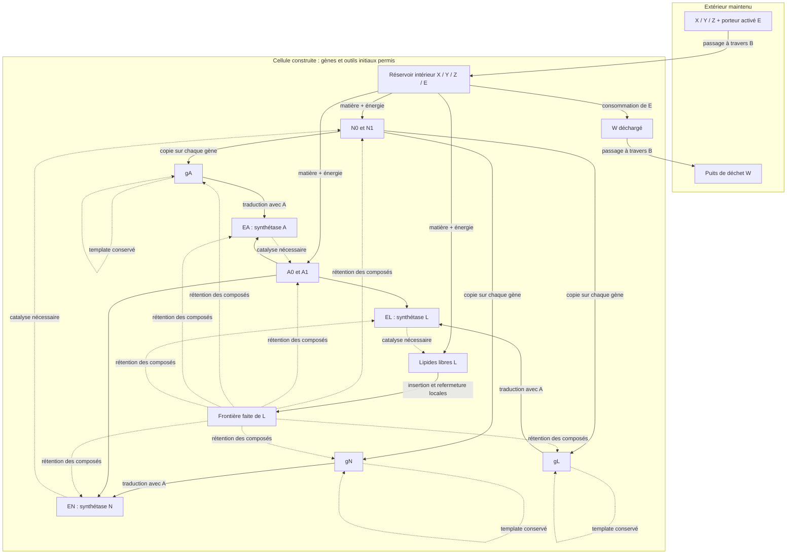
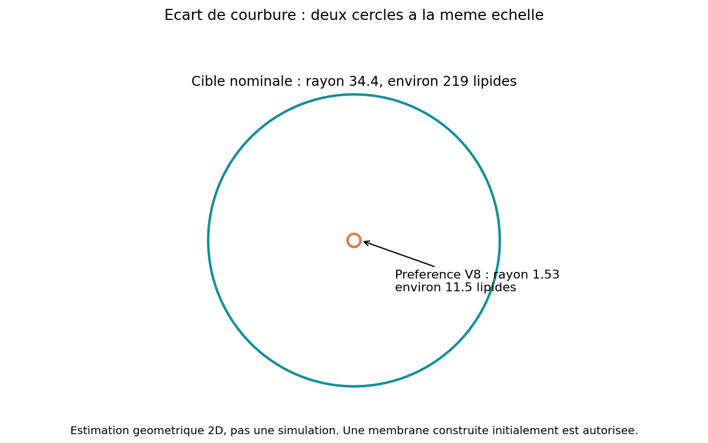
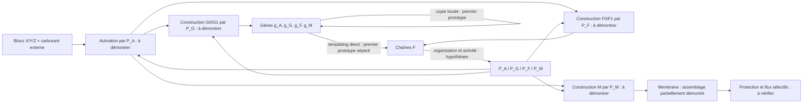

# Architectures de cellule : fermeture à concevoir, pas encore réalisée

## Cible révisée au lot7 — trois synthétases, trois gènes

25 octobre2026. [Spécification calculable](minimal_cell_spec.json),
[interactions et risques](CELL_INTERACTIONS.md), [tests futurs](INTEGRATION_TESTS.json),
[bilan](BATCH_07.md). L'ancien schéma C0 est conservé plus bas comme historique.

### Acquis complémentaire du lot8 et choix encore ouverts

Le [lot8](BATCH_08.md) réalise un sous-réseau sous des lois communes :

Six monomères F préparés amorcent les essais, sans chaîne F initiale. Les trois
graines expriment un outil et incorporent ses produits. Les ressources sont
spécialisées, la réaction utilise une accélération locale et un cycle externe.
La membrane et le maintien sous pertes restent absents. Ce prototype contient
102 billes et10 espèces cibles (4 précurseurs,4 dimères, G001 et F001), plus
les fragments/complexes. Ce n'est pas un dimensionnement de cellule complète.

Le schéma XYZ/isomères ci-dessous est une option de conception. L'utilisateur
n'impose ni trois aliments primitifs ni une composition identique de N et A.
Comparer à terme quatre précurseurs réutilisables et un assembleur polyvalent,
avec une vraie voie L construite sous le même alphabet, à la variante C0B. Ne
pas imposer une conversion XYZ inutile ; ne pas déclarer cet univers commun
avant d'y fabriquer et renouveler une frontière. Le budget16 espèces/2406 billes
reste celui des hypothèses C0B, pas une estimation révisée du candidat C3B1.

La cellule est construite au départ, avec gènes, outils et membrane. Elle doit
**renouveler** ces éléments depuis X/Y/Z et un porteur d'énergie activé E ; W
est le même porteur déchargé. L'extérieur doit être alimenté et évacué selon
un protocole déclaré ; la cible précisée est un flux au bord du domaine fini,
pas une concentration garantie autour de la cellule (OPEN_BOUNDARY.md).
Le système est ouvert en matière et en énergie ; la
fermeture recherchée concerne les dépendances fonctionnelles internes.

| Gène fragmenté | Chaîne F à exprimer | Fonction nécessaire | Produit utilisable |
| --- | --- | --- | --- |
| gN | EN | Synthétase de nucléotides | N0/N1, monomères des trois gènes |
| gA | EA | Synthétase d'acides aminés | A0/A1, monomères des trois outils, y compris EA |
| gL | EL | Synthétase de lipides | L polaire, qui doit s'insérer dans la frontière |

Ces noms sont des **rôles d'assemblages**, pas des types primitifs d'enzymes.
Les trois séquences fonctionnelles ne sont pas encore trouvées. Le candidat
n'ajoute ni polymérase ni ribosome : copie et traduction directe utilisent les
motifs locaux génériques recherchés dans les lots précédents. Si leur maintien
exige un outil supplémentaire, il faudra compter son gène et sa reconstruction.

**Les flèches se combinent par ET.** Un gène ne crée pas un outil sans A et
énergie ; un monomère ne crée pas un gène sans template ; le lipide n'est pas
devenu une membrane parce qu'il est présent dans le bain. Le graphe est un
cahier des charges conditionnel, pas un graphe de réactions implémentées.

## Matière et fermeture conditionnelle

Pour i=0/1, B_i=Y/Z :

- X+B_i+E → N_i+W, soutenu par EN.
- X+B_i+E → A_i+W, soutenu par EA.
- 2X+E → L+W, soutenu par EL.
- N0/N1 → chaque gène, sur une copie intacte de ce gène.
- A0/A1 → EN, EA ou EL, sur le gène correspondant.
- L intérieur → L dans la frontière, avec retour à une frontière étanche.

L'outil catalytique et le gène template restent présents des deux côtés.
N_i et A_i ont la même composition X+B_i mais **des états/ports de liaison
différents** ; confondre les deux échoue au transfert malgré un bilan atomique
correct. L a deux X avec des états locaux tête/queue. X/Y/Z/porteur donnent
quatre sortes matérielles primitives ; états E/W, trois modes de liens N/A/L,
polarité, ports de templating et capture constituent un coût supplémentaire.
Ce n'est pas encore l'alphabet commun validé par le moteur : C3A fournissait
P_G/P_F/R0/R1 et V8 ses H/T. Leur synthèse depuis X/Y/Z reste hypothétique.

L'énergie de comptabilité est un E par dimère et un E par liaison de polymère.
Elle sert à ne pas cacher un apport ; ce n'est pas une calibration énergétique,
et le travail du cycle externe de déliaison reste également à déclarer/mesurer.
Un faible fond spontané peut être toléré, mais il ne doit pas maintenir les
trois productions en l'absence des catalyseurs : tester l'ablation au flux requis.

EN dépend d'EA pour sa chaîne et d'EN pour son gène ; EA dépend d'EN et d'EA ;
EL dépend des deux, et la frontière qu'il renouvelle permet apports/rétention.
Le départ construit amorce ces cycles. Une perte de toutes les copies d'un
gène fragmenté n'est pas réparée par la seule présence de son outil : suivre
l'extinction génétique, sans promettre un maintien indéfini d'un petit stock.

L'audit `audit_cell_design.py` vérifie conservation matérielle, dépendances ET,
régénération des outils et voie jusqu'à L incorporé. Dix défauts injectés sont
détectés, dont absence d'expression, insertion ou transport, mauvaise matière,
monomère isomasse de la mauvaise famille et fabrication sans catalyseur.
Il ne vérifie ni sélectivité, ni conformation, ni vitesse, ni géométrie réelle.

## Inventaire chimique : 16 espèces cibles, pas seulement 16 possibilités

| Catégorie | Nombre d'espèces | Nombre de billes par molécule |
| --- | ---: | ---: |
| X, Y, Z | 3 | 1 |
| E et W, états du même porteur | 2 | 1 |
| N0/N1 et A0/A1 | 4 | 2 |
| Lipide L, libre ou inséré | 1 | 2 |
| gN/gA/gL | 3 | 2×longueur |
| EN/EA/EL | 3 | 2×longueur |
| **Total cible** | **16** | |

Un compartiment ou une vésicule n'ajoute pas une espèce moléculaire. Complexes
enzyme–substrat, duplex, intermédiaires et fragments sont des états/assemblages
supplémentaires non comptés dans16. Une famille binaire de longueur24 possède
déjà 2^24 séquences possibles avant identification par retournement : les
chimères et parasites ne disparaissent pas parce que l'inventaire cible est petit.

## Budget de particules : trois hypothèses de dimensionnement

Chaque monomère et chaque lipide comporte deux billes. On compte les chaînes,
les stocks libres, les précurseurs, E/W, la frontière et un halo externe fini.
Les longueurs12/24/48 sont des hypothèses ; aucun de ces choix n'est une longueur
fonctionnelle validée pour les trois synthétases.

| Hypothèse | Longueur par gène/outil | Copies par gène / outil | Billes intérieures | Lipides de frontière | Billes cellule | Halo externe | Total simulé |
| --- | ---: | ---: | ---: | ---: | ---: | ---: | ---: |
| Petite | 12 | 1 / 2 | 640 | 126 | 892 | 128 | **1 020** |
| Nominale | 24 | 2 / 4 | 1 712 | 219 | 2 150 | 256 | **2 406** |
| Plus grande | 48 | 3 / 8 | 4 864 | 458 | 5 780 | 512 | **6 292** |

Décomposition nominale :6 gènes =288 billes ;12 outils =576 ;96 N libres =192 ;
192 A libres =384 ;24 L libres =48 ;64 précurseurs bruts ;96 E ;64 W maximum.
Cela fait554 objets moléculaires intérieurs avant complexes, plus219 L dans
la frontière. Ce budget n'inclut ni solvant explicite, ni rendu, ni objets
externes représentant un réservoir infini : un halo256 doit être réapprovisionné
par une condition de frontière locale explicite, ou le domaine externe agrandi.

Le rayon intérieur est estimé par a/2×sqrt(N/φ), a=0,7, avec fraction d'aire
effective φ=0,25/0,20/0,12 et un contrôle de longueur droite des gènes. On ajoute
une marge2 pour la membrane ; ce choix de remplissage est une hypothèse grossière,
car les billes R peuvent se superposer. Les rayons de membrane sont19,7/34,4/72,5.
Le nombre de lipides vient de la circonférence, pas d'un multiplicateur arbitraire.

À stocks nominaux constants, une insertase ajoute gI et EI :**18 espèces cibles,
2 726 billes**. Une fonction d'activation interne ajoute pareillement gQ/EQ ;
les deux donnent20 espèces et3 044 billes. Ce sont des coûts de dépendances
à assumer, pas des fonctions réalisées ni des réseaux supplémentaires validés.

Renouveler une fois les6 gènes,12 outils et219 lipides de frontière demande,
sous la stœchiométrie choisie,870 X +216 Y +216 Z +1 065 E et rejette1 065 W.
Les stocks libres sont exclus de ce lot de remplacement. Ce n'est pas un débit
de maintenance : il faudra mesurer les pertes et les vitesses de chaque voie.

## Premier problème révélé : courbure et taille ne concordent pas

V8curved utilise longueurs de rangées1/0,65 et épaisseur h=0,65. Pour un anneau
polygonal sans contrainte, Δℓ=2h sin(π/n) : n≈11,5 et rayon médian≈1,53.
Cela explique les petits contours observés ; ce n'est pas une capacité d'accueil
pour1 700 billes. Un anneau préparé beaucoup plus grand peut être contraint,
mais sa stabilité, son coût de courbure et son risque de bourgeonnement restent à tester.

Avec ℓ_ext=1 et rayon nominal34,4, la géométrie sans contrainte exigerait
ℓ_int≈0,9813, contre0,65 actuellement. Il ne suffit pas d'augmenter `units`.
Deux pistes : courbure faible et souple commune aux L, ou courbure résultant
localement du remplissage/tension. La cellule peut commencer construite ; tester
d'abord stabilité, échange et insertion d'une grande frontière, avant d'exiger
son assemblage spontané intégral. Ce n'est pas une loi utilisant un rayon global.

## Insertion et transport : obligations explicites

Un anneau dont toutes les faces sont saturées n'offre aucun port à un L neuf.
La voie de référence est l'ouverture/échange **local réversible**, capture du L
arrivé depuis dedans, puis refermeture. Observer incorporation à la frontière
initiale, remplacement d'anciens L, fuite pendant l'ouverture et nombre de
micelles internes. Adsorption ou nouvelle vésicule interne ne valent pas insertion.

Si cette voie échoue avec un diagnostic, envisager EI/gI : l'insertase elle-même
doit être traduite et renouvelée, et ne doit pas rester prisonnière de la membrane.
Ni reconnaissance de contour ni critère dynamique « intérieur » ne sont permis.

X/Y/Z/E/W doivent traverser ; N/A, gènes et outils doivent rester sans coller.
Comme les mêmes X/Y/Z constituent les composés, une matrice de répulsion fondée
uniquement sur les types primitifs ne suffit pas. Un profil dépendant de
l'occupation **locale** des liens est une piste autorisée, non encore validée.
Les taux de passage, fuite et adsorption doivent être mesurés dans le même bain.

Prochaine priorité : [contrats d'interaction et tests de réfutation](CELL_INTERACTIONS.md).
Une fermeture du graphe peut être correcte alors que les réactions parasites,
la dilution, le transport ou la saturation rendent le système non viable.

Historique : première architecture C0 du23 octobre2026, non actualisée ci-dessous

## Frontière choisie

La cellule initiale peut être construite et contenir ses gènes et ses outils.
Les apports maintenus sont trois blocs génériques X/Y/Z et un carburant activé.
L'objectif est de pouvoir refaire les gènes, les chaînes fonctionnelles et la
membrane à partir de ces apports, malgré le renouvellement de matière.

L'architecture de travail conserve deux familles : G pour l'information et F
pour les outils. La traduction est un templating direct G_i–F_i, pas une copie
du système ribosome/ARN moderne. L'alternative à une seule famille R reste ouverte.

## Candidat de travail : quatre fonctions, un alphabet réutilisable

| Rôle abstrait | Fonction requise | Production requise de l'outil |
| --- | --- | --- |
| P_A | Activer les blocs X/Y/Z en consommant du carburant | Expression de g_A en chaîne F, puis organisation active |
| P_G | Assembler les sous-unités G0/G1 à partir des blocs activés | Expression de g_G en chaîne F |
| P_F | Assembler les sous-unités F0/F1 | Expression de g_F en chaîne F |
| P_M | Construire les unités de membrane M | Expression de g_M en chaîne F |

Ces noms sont **des fonctions à obtenir par différentes séquences**, pas de
nouveaux types de particules qui sauraient être « enzyme A ». Le moteur n'a pas
de table associant une séquence entière à ces fonctions. Les séquences binaires
de six symboles retenues dans l'audit sont des exemples de comptabilité, et non
des séquences dont nous aurions démontré les activités souhaitées.

Cette architecture évite d'exiger immédiatement une polymérase ou une machinerie
de traduction : le motif de ligation local est une opportunité primitive de la
chimie conçue. Cela ne dispense pas de fabriquer les bons monomères, d'obtenir
les conformations catalytiques et de libérer les produits.

## Audit formel effectué

`experiments/audit_causal_network.py` génère et vérifie trois réseaux. Ses sources,
réactions complètes, hypothèses et résultats sont archivés dans
`research/abstract_runs/C0_20261023T131308019594Z/`.

Les sous-unités sont comptabilisées comme G0/F0 = X+Y, G1/F1 = X+Z et M = 2X.
Les G et F de même symbole ont donc ici la même composition élémentaire, mais
des états de liens différents supposés constructibles. Chaque activation utilise
un carburant qui devient déchet ; son porteur est aussi comptabilisé. C'est une
abstraction des éléments et des états, pas une chimie énergétique calibrée.

| Variante | Outils fonctionnels supposés | Coût d'un lot de remplacement choisi |
| --- | ---: | ---: |
| Deux familles, outils spécialisés | 4 | 98 activations/carburants |
| Deux familles, un assembleur polyvalent + activation | 2 | 50 activations/carburants |
| Une famille R portant information et fonction | 3 | 38 activations/carburants |

Un lot remplace une copie de chaque gène et de chaque outil, plus une unité M.
Pour R, gène et outil sont le même objet. Ces coûts dépendent des séquences
arbitraires de six symboles et de cette comptabilité. Ils ne mesurent ni efficacité,
ni rendement, ni minimalité mathématique. La variante à deux outils suppose
précisément la polyvalence qui reste à obtenir ; la variante R suppose une
alternance compatible entre conformation fonctionnelle et conformation templante.

Vérifications réalisées :

- Chaque réaction conserve X/Y/Z et le porteur du carburant.
- Avec les gènes et outils initiaux autorisés, chaque classe essentielle peut
  être produite, et pas simplement être présente dans l'état de départ.
- Tous les catalyseurs supposés ont une voie de régénération interne.
- Un bilan de flux explicite peut remplacer les objets choisis sans créer de
  matière ; le carburant et les déchets restent des flux externes déclarés.
- Retirer la voie de production de chaque outil fait échouer l'audit, même si
  l'outil est présent au départ. Un mauvais élément dans une réaction ou un
  monomère élaboré dissimulé dans la nourriture sont également détectés.

Les trois réseaux passent, car ils ont été construits pour satisfaire ces
contraintes. **Cela vérifie la cohérence d'un cahier des charges conditionnel.**
Cela ne prouve aucune activité catalytique, vitesse, maintien de concentrations,
division ou réalisation spatiale. Les réactions macro « produire P_A » et
« produire un gène » appartiennent uniquement à l'audit, jamais aux règles du
moteur de particules.

## Choix provisoire et obligations suivantes

Le candidat à deux familles et quatre rôles est le plus explicite pour organiser
les expériences : chaque fonction manquante a son test. Le candidat polyvalent
reste intéressant pour compacter le réseau si une même géométrie réalise plusieurs
assemblages contrôlables. Le candidat R n'est pas rejeté ; son avantage de
comptabilité doit être confronté au conflit physique entre templating et fonction.

Pour passer du schéma à la cellule, il manque surtout :

1. Un assemblage issu d'une séquence qui réalise plusieurs cycles d'une opération
   chimique locale mesurable, avec libération du produit et contrôle par variante.
2. La construction effective de sous-unités G/F/M à partir de blocs plus simples,
   avec les bons ports et états ; les pools actuels sont préparés à l'avance.
3. La compatibilité copie/expression dans un même bain : les essais E0mixed/E2mixed
   montrent une concurrence de recrutement. Une seconde face de reconnaissance
   ou un couplage local mieux conçu est à explorer.
4. Le remplacement d'un outil réellement consommé/dégradé par les outils produits
   par le système, puis la rétention, les déchets et les flux de membrane.

L'audit formel sert à ne pas oublier une dépendance. Les expériences moléculaires
devront décider si cette architecture est faisable ou doit être redessinée.

## État moléculaire après le lot9

La frontière préparée à219 L est testée sur534 billes avec sondes, sans charge
G/F. Réduire la courbure suffit au criblage de stabilité ; un échange activé local
permet deux insertions sur une graine, sans insertase primitive. Rien n'ajoute donc
encore gI/EI au graphe cible. Énergie de cet échange non calibrée ; sa production
depuis une machinerie et la fabrication de L restent ouvertes. Budget C0B2406
inchangé et conditionnel. Les aliments/déchets réels et leurs états de liaison
ne sont pas remplacés par les sondes du test. Voir BATCH_09.md et LOCALITY_AUDIT.md.
# Obligation de maintien et essais de domaine

Le contrat [HOMEOSTASIS.md](HOMEOSTASIS.md) précise la cible : faibles bandes
de stocks, prévention des accumulations et des extinctions, récupération après
perturbation. Il n'ajoute pas encore d'outil à C0B ; tout outil nécessaire
de recyclage/régulation devra avoir son gène et sa voie de renouvellement.
Le budget conditionnel2406 reste inchangé et peut être révisé sur ces besoins.
J2 est un contrôle sans membrane à102 billes, pas un nouveau dimensionnement
de cellule ni un confinement artificiel à réutiliser dans sa dynamique.

J3 teste102/816/1632 billes génétiques avec486 billes L constantes, soit
588/1302/2118 au total. Il s'agit de copies multiples du seul001, pas des trois
synthétases C0B ou d'une longueur24 démontrée. Les copies préparées sont fournies
et ne comptent pas comme renouvellement. Le budget final reste conditionnel ;
les futures particules d'apport/sortie devront s'ajouter au bilan dynamique.
