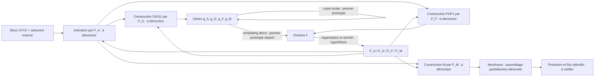

# Architectures de cellule : fermeture à concevoir, pas encore réalisée

## Frontière choisie

La cellule initiale peut être construite et contenir ses gènes et ses outils.
Les apports maintenus sont trois blocs génériques X/Y/Z et un carburant activé.
L'objectif est de pouvoir refaire les gènes, les chaînes fonctionnelles et la
membrane à partir de ces apports, malgré le renouvellement de matière.

L'architecture de travail conserve deux familles : G pour l'information et F
pour les outils. La traduction est un templating direct G_i–F_i, pas une copie
du système ribosome/ARN moderne. L'alternative à une seule famille R reste ouverte.

## Candidat de travail : quatre fonctions, un alphabet réutilisable

| Rôle abstrait | Fonction requise | Production requise de l'outil |
| --- | --- | --- |
| P_A | Activer les blocs X/Y/Z en consommant du carburant | Expression de g_A en chaîne F, puis organisation active |
| P_G | Assembler les sous-unités G0/G1 à partir des blocs activés | Expression de g_G en chaîne F |
| P_F | Assembler les sous-unités F0/F1 | Expression de g_F en chaîne F |
| P_M | Construire les unités de membrane M | Expression de g_M en chaîne F |

Ces noms sont **des fonctions à obtenir par différentes séquences**, pas de
nouveaux types de particules qui sauraient être « enzyme A ». Le moteur n'a pas
de table associant une séquence entière à ces fonctions. Les séquences binaires
de six symboles retenues dans l'audit sont des exemples de comptabilité, et non
des séquences dont nous aurions démontré les activités souhaitées.

Cette architecture évite d'exiger immédiatement une polymérase ou une machinerie
de traduction : le motif de ligation local est une opportunité primitive de la
chimie conçue. Cela ne dispense pas de fabriquer les bons monomères, d'obtenir
les conformations catalytiques et de libérer les produits.

## Audit formel effectué

`experiments/audit_causal_network.py` génère et vérifie trois réseaux. Ses sources,
réactions complètes, hypothèses et résultats sont archivés dans
`research/abstract_runs/C0_20261023T131308019594Z/`.

Les sous-unités sont comptabilisées comme G0/F0 = X+Y, G1/F1 = X+Z et M = 2X.
Les G et F de même symbole ont donc ici la même composition élémentaire, mais
des états de liens différents supposés constructibles. Chaque activation utilise
un carburant qui devient déchet ; son porteur est aussi comptabilisé. C'est une
abstraction des éléments et des états, pas une chimie énergétique calibrée.

| Variante | Outils fonctionnels supposés | Coût d'un lot de remplacement choisi |
| --- | ---: | ---: |
| Deux familles, outils spécialisés | 4 | 98 activations/carburants |
| Deux familles, un assembleur polyvalent + activation | 2 | 50 activations/carburants |
| Une famille R portant information et fonction | 3 | 38 activations/carburants |

Un lot remplace une copie de chaque gène et de chaque outil, plus une unité M.
Pour R, gène et outil sont le même objet. Ces coûts dépendent des séquences
arbitraires de six symboles et de cette comptabilité. Ils ne mesurent ni efficacité,
ni rendement, ni minimalité mathématique. La variante à deux outils suppose
précisément la polyvalence qui reste à obtenir ; la variante R suppose une
alternance compatible entre conformation fonctionnelle et conformation templante.

Vérifications réalisées :

- Chaque réaction conserve X/Y/Z et le porteur du carburant.
- Avec les gènes et outils initiaux autorisés, chaque classe essentielle peut
  être produite, et pas simplement être présente dans l'état de départ.
- Tous les catalyseurs supposés ont une voie de régénération interne.
- Un bilan de flux explicite peut remplacer les objets choisis sans créer de
  matière ; le carburant et les déchets restent des flux externes déclarés.
- Retirer la voie de production de chaque outil fait échouer l'audit, même si
  l'outil est présent au départ. Un mauvais élément dans une réaction ou un
  monomère élaboré dissimulé dans la nourriture sont également détectés.

Les trois réseaux passent, car ils ont été construits pour satisfaire ces
contraintes. **Cela vérifie la cohérence d'un cahier des charges conditionnel.**
Cela ne prouve aucune activité catalytique, vitesse, maintien de concentrations,
division ou réalisation spatiale. Les réactions macro « produire P_A » et
« produire un gène » appartiennent uniquement à l'audit, jamais aux règles du
moteur de particules.

## Choix provisoire et obligations suivantes

Le candidat à deux familles et quatre rôles est le plus explicite pour organiser
les expériences : chaque fonction manquante a son test. Le candidat polyvalent
reste intéressant pour compacter le réseau si une même géométrie réalise plusieurs
assemblages contrôlables. Le candidat R n'est pas rejeté ; son avantage de
comptabilité doit être confronté au conflit physique entre templating et fonction.

Pour passer du schéma à la cellule, il manque surtout :

1. Un assemblage issu d'une séquence qui réalise plusieurs cycles d'une opération
   chimique locale mesurable, avec libération du produit et contrôle par variante.
2. La construction effective de sous-unités G/F/M à partir de blocs plus simples,
   avec les bons ports et états ; les pools actuels sont préparés à l'avance.
3. La compatibilité copie/expression dans un même bain : les essais E0mixed/E2mixed
   montrent une concurrence de recrutement. Une seconde face de reconnaissance
   ou un couplage local mieux conçu est à explorer.
4. Le remplacement d'un outil réellement consommé/dégradé par les outils produits
   par le système, puis la rétention, les déchets et les flux de membrane.

L'audit formel sert à ne pas oublier une dépendance. Les expériences moléculaires
devront décider si cette architecture est faisable ou doit être redessinée.
