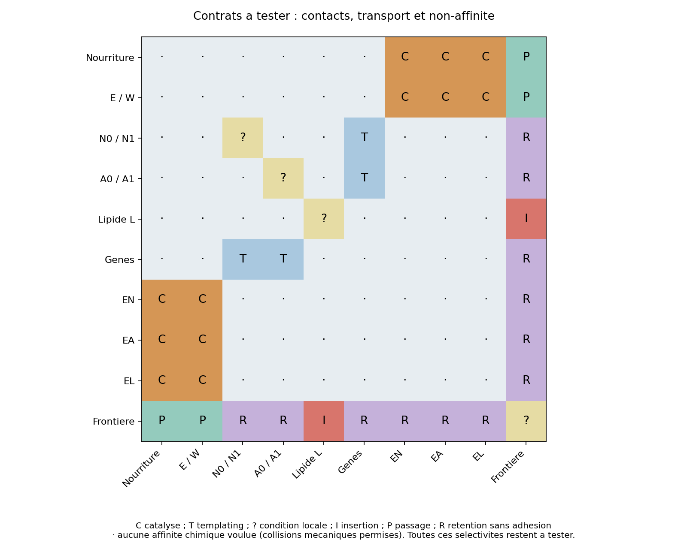

# Interactions souhaitées, parasites et environnements — lot7

[Spécification](minimal_cell_spec.json), [graphe et budget](CELL_ARCHITECTURE.md),
[campagnes futures](INTEGRATION_TESTS.json). Les lignes ci-dessous sont des
**obligations à tester**, pas une matrice déjà implémentée et validée.

Lot8 : capture P/R, libération et transfert vers G/F sont testés sous C3B1,
avec3/3 incorporations,2/3 copies G complètes issues des produits et1/3
renouvellement de F. Le contrôle délié peut se réexprimer en enzyme : une classe
initialement inactive n'est pas nécessairement inoffensive à long terme.
La sélectivité XYZ/N/A de même composition reste une option C0B ; le prototype
à quatre précurseurs est polyvalent. Les autres contrats, notamment L/frontière,
ne sont pas validés par cette preuve partielle.

La matrice regroupe16 espèces cibles en10 classes. Une case vide demande
l'absence d'affinité chimique persistante voulue, pas l'absence de collision.
Les complexes transitoires nécessaires à une réaction ou hérités d'une copie
doivent pouvoir se défaire. Les flèches de synthèse requièrent plusieurs réactifs
simultanés : des cases par paires ne suffisent pas à spécifier une catalyse.
La frontière est faite des mêmes L : ses contacts latéraux internes réutilisent
la condition L–L. « Frontière » indique ici un contexte de passage/insertion,
jamais un type d'agrégat lu par la dynamique. La case catalyse E/W concerne E
actif ; W doit être relâché et ne pas garder une affinité inhibitrice.

| Rencontre / contexte | Effet utile attendu | Effet parasite à mesurer | Test décisif |
| --- | --- | --- | --- |
| X avec Y/Z, EN et énergie | N0/N1 avec ports G | A incorrects, XY inertes, inhibition par substrat | EN seul, EA seul, les deux ; vérifier l'usage du produit dans une copie |
| Même nourriture avec EA | A0/A1 avec ports F | N incorrects ; concurrence d'EN | Incorporation dans un outil exprimé puis activité, mêmes lois |
| 2X avec EL et énergie | L polaire libéré | Colle non spécifique ou couche de L sur EL | Produit libéré puis insertion ; comparaison EL absent |
| E/W et sites actifs | Consommer E, relâcher W | W garde les sites occupés | Dose croissante de W, flux utile et temps d'occupation |
| N/A et trois gènes | Copie ou expression alignée | Blocage mutuel, chimères, accaparement par un gène | Trois gènes puis ajout de chacun ; comptes par origine, pas total global |
| Outils F et gènes/N/A | Fonction sans templating parasite | Repliement détruit, dimères adsorbés, gènes immobilisés | Outils présents/absents à encombrement égal |
| L libre et frontière saturée | Échange, insertion et étanchéité retrouvée | Adsorption seule, nouvelle micelle, fuite irréversible | L produit dedans ; tracer IDs et frontière initiale en analyse |
| L libre et reste du contenu | Aller à la frontière | Enrobage des gènes/outils, micelles internes | Bain complet, mesurer fraction de L incorporée et surface d'adsorption |
| Nourriture libre et frontière | Passage selon gradient entretenu | Aucun apport ou nourriture adsorbée | Taux d'import sous consommation réelle, pas diffusion seule |
| N/A et frontière | Rétention sans adhésion | Perte des stocks ou sites collés | Passage/adsorption des mêmes atomes libres puis liés |
| Fragments N/A et chimères | Élimination/finition éventuellement utile | Pièges irréversibles, parasitisme de templates | Ajout dosé, suivi du flux cible et recyclage |

## Pas de catalogue de règles par espèce fonctionnelle

EN/EA/EL sont des formes à obtenir par différentes séquences du **même alphabet**.
Le diagramme ne permet pas d'introduire une réaction `if enzyme == EN` ni une
table de séquence complète dans le moteur. La différence N/A à composition
égale doit découler de ports/états et de géométries locales réutilisables.
La libération par occupation du lien produit est une aide réutilisable possible.
Ajouter une liaison, un port ou un état impose de déclarer son coût et de
retester les autres fonctions sous ces mêmes lois.

Le besoin de profils de contact dépendant du lien est particulièrement clair :
si X libre traverse mais X dans N est retenu, le type X seul ne peut pas porter
ces deux propriétés. Il faut un état local de liaison, un filtrage géométrique
réellement mesuré, ou un autre mécanisme explicite. Le statut « gène » reconnu
par l'observateur ne doit jamais modifier une force.

## Campagne d'intégration progressive

1. Figer un candidat et ses références isolées. Déclarer les seuils avant les essais.
2. Ajouter chaque classe étrangère, puis toutes ensemble, à concentrations
   0,25×/1×/4×, avec un contrôle d'encombrement inerte de mêmes contacts mécaniques.
   Distinguer dilution, épuisement du substrat, adsorption et vraie réaction parasite.
3. Mesurer flux utile **incorporé dans l'étape suivante**, produits incorrects,
   temps de séquestration, taux de fuite et matière enfermée dans les fragments.
   Un produit de bonne composition mais de mauvais état ne compte pas.
4. Ajouter frontière, renouvellement et pertes seulement après les premières
   compatibilités ; réutiliser les mêmes lois. Tester les arrivées de L depuis
   dedans, sans utiliser ce label dans la dynamique.
5. Supprimer chaque fonction à tour de rôle. Une voie est causalement nécessaire
   si son absence fait tomber son flux sous les pertes à compenser, même si
   un faible fond spontané subsiste. Un seul résultat favorable ne suffit pas.

Les premiers seuils de criblage proposés (au moins moitié du flux isolé après
contrôle d'encombrement et moins de5% d'incorporations incorrectes) sont
**provisoires**, pas des critères validés de viabilité. Leur insuffisance peut
être immédiate pour un gène long : si une erreur indépendante par liaison a
probabilité ε, la fraction intacte est (1−ε)^(longueur−1). À24 unités, ε=0,05
donne seulement environ31% de chaînes sans erreur. Il faudra donc un objectif
plus strict ou de la réparation/du tri ; ne pas cacher ce coût.

Une absence d'événement parasite observé ne démontre pas une interdiction.
Rapporter l'exposition et les conséquences : une collision réversible peut
être bénigne, une liaison rare mais irréversible peut vider le stock à long terme.
Les états partiels, les concentrations extrêmes et le vieillissement du bain
sont des environnements du test, pas des détails ajoutés après intégration.

## Verrous révélés tôt et pistes de solution

- **Sélectivité de trois outils** : aucune bibliothèque EN/EA/EL n'existe encore.
  Tester deux états de produit distincts depuis les mêmes ressources avant de
  poursuivre une grande cellule ; C3A seul ne le démontre pas.
- **Trois gènes plus longs** : coexistence à six symboles déjà difficile pour un
  seul gène. Les24 unités sont un budget et non une longueur maîtrisée. T9,
  compétition et fidélité doivent être attaqués avec plusieurs templates.
- **Courbure de frontière** : V8 préfère une dizaine de L ; le budget demande
 126–458. Tester une frontière préparée à faible courbure et échange local,
  sans faire dépendre ses lois d'un rayon global.
- **Insertion dans un anneau saturé** : une liaison réversible ou un échange local
  est nécessaire dans la représentation à faces saturées. Comparer les fuites ;
  si EI est ajouté, inclure gI, sa production et ses propres interactions parasites.
- **Dilution et flux de surface** : à remplissage fixé, le contenu croît comme
  R² et la frontière comme R. Agrandir pour loger plus d'outils réduit la surface
  disponible par consommateur. Confronter import mesuré et besoins, pas seulement
  la capacité géométrique. Les valeurs de diffusion/réaction manquent encore.
- **Extinction d'un gène fragmenté** : deux copies peuvent être perdues ensemble.
  Tester nombre de copies et durée de maintien ; un génome unique demanderait
  une expression par segments non présente dans le templating direct actuel.

Ce sont des risques concrets du candidat. Aucun n'est un argument pour écrire
des milliers de corrections locales : les tests I0–I4 doivent décider tôt s'il
faut changer les ports, le recyclage ou la représentation membranaire.

## Test partiel I2–I4, lot9

Frontière219 L préparés : faible courbure maintenue, sélectivité de sondes obtenue
par contacts locaux, barrière de lien ablatable dans S. B donne une insertion
rare par échange à six billes ; aucun contour/indice intérieur n'est lu dans les
lois. Sans attraction ou ancienne courbure, la frontière se fragmente. Un état
non classable n'est pas une preuve de rétention. Le test ne contient aucun vrai
G/F ni nourriture/déchet, aucun L fabriqué : contrats de transport et de non-
interaction biologique toujours ouverts. Le helper d'échange pourrait défaire
des assemblages étrangers si on le généralise ; mesurer ces réactions parasites
avant l'unification. Sources, cas et limites dans BATCH_09.md.

## Contrôle de robustesse M1R

K1 observe insertion B3/3 à1500, mais critère de fermeture2/3 et beaucoup
d'inconnu pour B0 ; supprimer la barrière de lien donne des pertes2–4/24.
Le lot11 conserve cette aide et compare l'échange à son ablation, sans nouveaux
types ni fonctions. Les diagnostics n'ajoutent aucun transport réel d'aliments,
déchets ou G/F ; les contrats matériels restent ouverts et le budget inchangé.

## Variante G1, occupation des autres ports

Un swap est refuse quand les autres ports des deux partenaires sont occupes.
La condition est locale et symetrique, mais reduit des echanges entre segments ;
sa reutilisation dans une chimie commune et ses effets parasites restent a
tester. Aucune insertase ni gene ajoute : loi primitive conditionnelle declaree,
avec l aide activee de B toujours fournie. Budget534 billes et cible C0B inchanges.

## J0 — premier contrat de contact P/R–L

Le banc J0 contient588 billes :243 L à deux billes et51 supports/reconnaisseurs
(102 billes). Les sondes artificielles sont retirées. P/R libres sont transparents
aux L ; le lien réel P–R active la répulsion de billes et segment0,55/80.
L'affinité chimique P/R–L est nulle par contrat de types, non par label de gène.
Cette sélectivité est implémentée, pas encore validée en flux fonctionnel.
La commutation d'énergie est une aide déclarée. Aucun outil/gène ajouté et
budget cible C0B inchangé ; le petit test n'est pas une cellule dimensionnée.

Production de L par F non implémentée ; un changement de représentation est
requis, sans conversion externe ni simple renommage P/R. J0 vérifie d'abord
cohabitation, contacts, dilution et température ; les autres contrats restent
conditionnels, y compris transport sous consommation et renouvellement.

GKA (lot14) instrumente les motifs génétiques existants pour analyser l'échec
à froid avant d'ajouter une autre interaction. Aucun type, outil/gène ou coût
particulaire changé. Les réactions chimiques P/R–L restent absentes ; aucune
sélectivité supplémentaire n'est déduite de cet observateur.

## J1 achevé et témoin J2

Fabrication froide préparée et incorporation3/3 dans la petite boîte ; aucune
incorporation dans les6 bains avec L. Le stock monomère y existe, éloigné du gène.
Le contraste J2 retire L et compare deux boîtes globales avec paquet initial
identique : contrôle d'environnement, pas nouveau mécanisme cellulaire.
Réactions, alphabet et budget nominal inchangés. Le contrôle compact ne peut
pas contenir L ; aucune paroi interne autour du gène n'est autorisée.

L'homéostasie faible exige en plus des flux un contrôle d'accumulation et de
récupération après pénurie ; voir HOMEOSTASIS.md et test prospectif I9. Le
recyclage pourrait changer les contrats libre/lié et la perméabilité : les
réévaluer ensemble, sans supposer une fonction de nettoyage gratuite.

J2 terminé : compact préparé incorpore3/3, grand1/3, aucun G/F complet. J3
augmente l'inventaire intérieur plutôt que changer les affinités : contacts et
étanchéité doivent être effectivement exposés, même si le paquet commence au
centre. Une absence de contact avec L ne valide pas une rétention durable.

Le futur flux environnemental est injecté au bord du monde (OPEN_BOUNDARY.md),
pas à la membrane ni dans le cytoplasme. Mesurer import utile, gradients et
export des déchets sous consommation réelle ; aucune concentration locale
ne sera garantie par une règle globale qui comble les déficits.

J3 donne du transfert utile avec L àK16 sur3/3, avec rencontres libres contre
L et passage observé, mais très peu de contacts liés dans certaines graines.
Des périodes inconnues subsistent : aucune rétention globale prouvée. Les
monomères s'accumulent tandis que des fragments F libérés perdent la recapture
génétique ; de futures modifications T9 devront retester collage parasite,
accessibilité des gènes et catalyse des fragments, pas les déclarer tous inertes.
N1 conserve exactement ces interactions et raffine conjointement mécanique
et ticks réactionnels avant d'attribuer une rareté à la chimie.
