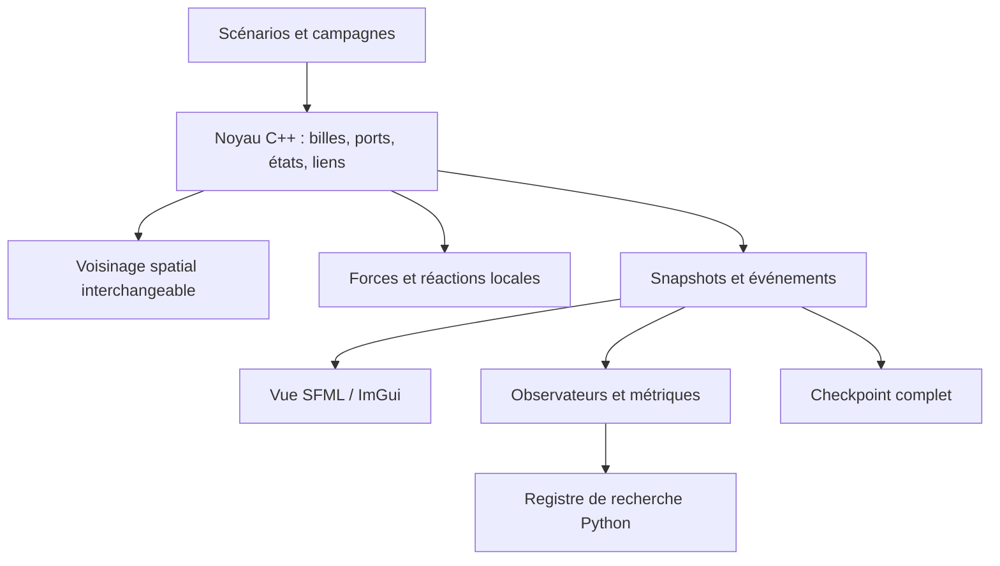

# Ce que l'ancien projet apporte à la recherche actuelle

Revue du 23 octobre 2026 du dossier temporaire `temp/`, fourni par l'utilisateur.
Lecture du code, des documents, des tests et du patch ; **aucune exécution de
l'ancien moteur et aucune nouvelle validation de ses résultats**.

Les sources utiles sont conservées dans [legacy_reference/source](legacy_reference/source/),
avec leur [inventaire et SHA-256](legacy_reference/manifest.json), leur licence MIT
et une [configuration observée extraite du checkpoint](legacy_reference/observed_checkpoint_parameters.json).
Cette note et ces références resteront utilisables après suppression de `temp/`.

## Les trois modèles à distinguer

| Modèle lu | Fonction portée par la particule | Ce qui est intéressant pour nous |
| --- | --- | --- |
| Historique F/A/B/S/L | Catalyse et surfactant S déjà définis à ce niveau | Couplage ressources → matière membranaire, perméabilité par interactions sélectives, force et couple anisotropes |
| Extension P | Deux ports saturables et courbure préférée par particule | Association, rupture, reformation locales ; liaisons indépendantes de la grille ; exclusion séparée de l'adhérence |
| Démonstrateur de copie | Symbole binaire et ports de squelette/appariement par monomère | Filtre anti-oligomères, alignement, séparation active et cycle, recensement des produits |

Ces modèles sont des références mécaniques et des réservoirs d'astuces. Ils
n'établissent pas encore l'indirection par assemblages que nous cherchons :
le lipid-like S/P et le monomère de copie sont ici des particules primitives.
Les fonctions pourront être redistribuées entre les constituants d'agrégats.

## 1. Lois et astuces chimiques à conserver

### Perméabilité sélective obtenue en omettant certaines interactions

Dans `simulation.cpp:632–697`, S interagit avec S, et repousse A/B/L ; la paire
S-F n'a pas de force spécifique dans ce dispatch. La ressource F peut donc
traverser la membrane alors que d'autres espèces sont repoussées. Il n'y a pas
besoin d'un détecteur d'intérieur pour accorder ce passage.

La répulsion S–A/B/L est aussi volontairement asymétrique : son facteur vaut
10 pour la particule contenue et 0.001 pour S. C'est une simplification utile à
identifier, pas une interaction réciproque à présenter comme telle. Elle permet
de repousser un contenu sans déplacer autant la membrane.

**Transfert possible :** une matrice de contacts par types et états, avec
superposition permise pour certains couples. Premier test : deux solutés de même
mobilité, mais de contact différent avec les mêmes constituants membranaires ;
mesurer traversées et rétention, sans utiliser l'intérieur dans les forces.

### Petite boucle de transformation de ressources

Les rencontres proches effectuent schématiquement `A + F -> A + B`, puis
`B + F -> A + S`. C'est un exemple compact de couplage entre amplification de
la chimie interne et production de membrane. Les réactions changent des types
sur place, sans création de particule nouvelle à ces étapes.

**Transfert possible :** garder ce schéma causal pour une première fermeture
matérielle, en remplaçant S par des précurseurs destinés à construire un agrégat.
L'assemblage et l'activation de ce précurseur à une interface resteraient des
réactions locales. Cette transposition est proposée, non testée ici.

Le README distingue une démonstration de formation spontanée et une autre de
croissance/reproduction, avec apport extérieur et préparation manuelle. Ne pas
transformer cette description en preuve d'un régime autonome unique.

La branche avec le limiteur L réalise globalement `L + A -> F + L`, avec une
affectation aux particules dépendant de l'ordre du parcours. Elle fournit une
idée supplémentaire : une espèce extérieure qui dégrade la catalyse non protégée,
tandis que la membrane limite son entrée et laisse passer la ressource F.
**Piste M0 :** tester cette protection par sélectivité des contacts, sans que la
réaction consulte une étiquette intérieur/extérieur. Vérifier aussi que le
limiteur ne détruit pas la chimie des compartiments qu'il atteint. La protection
effective n'est pas validée par cette lecture du code.

### Une membrane par anisotropie de force ET de couple

`calculateSurfactantForceAndTorque` (`simulation.cpp:138`) combine les angles
entre orientations et direction du contact, une transition attraction/répulsion,
une force non nécessairement radiale et un couple qui favorise un angle relatif.
L'amortissement dépend des vitesses et rotations relatives.

Le paramètre nommé `divisionAngle` est utilisé dans cette loi d'orientation
locale ; ce n'est pas un test global déclenchant une division. C'est une bonne
illustration d'un comportement macroscopique guidé par une préférence locale.

**Transfert possible :** catalogue réduit de contacts directionnels, angles et
amortissements entre composants. La géométrie d'un composé doit ensuite déterminer
sa courbure effective. Notre ruban à deux longueurs reste une voie complémentaire.

### Ports saturables + mécanique des liens + répulsion indépendante

Dans `updatePatchBonds` (`simulation.cpp:324`), un port droit ne peut lier qu'un
port gauche libre, sous contraintes de proximité des sites et d'angle. Les deux
orientations d'une paire sont évaluées. La préférence angulaire est locale.

Dans `applyPatchBondForces` (`simulation.cpp:457`), un ressort corrige l'erreur
entre les sites ; le levier du point d'attache produit un couple ; un autre
terme corrige l'angle relatif, avec amortissement. La répulsion des cœurs est
séparée dans `applyPatchCoreRepulsion` : une membrane saturée peut toujours
repousser une autre membrane sans pouvoir s'y coller.

**À reprendre :** garder indépendants le volume exclu, l'attraction de capture,
la valence chimique et la mécanique d'un lien formé. Ce découplage est directement
pertinent pour nos amas et nos contacts mal enregistrés.

### Rupture locale pour sortir des pièges

Les liens P peuvent rompre si l'erreur de position ou d'angle dépasse un seuil,
ou stochastiquement avec `p = 1 - exp(-temperature * rate * dt)`. Ils ne dépendent
pas de la reconnaissance d'un contour. Le protocole décrit chauffe/agite,
modifie le régime, puis refroidit pour permettre des réassemblages.

**Piste V7, prioritaire :** ajouter à V6 une rupture dépendant de la contrainte
locale, puis une composante thermique et un éventuel recuit. Comparer au modèle
irréversible à conditions initiales égales. Mesurer les amas durables, les boucles
simples et leur persistance, et pas seulement une fermeture instantanée.

Attention au séquencement : l'ancien `updatePatchBonds` casse puis reforme dans
le même appel. Un lien thermiquement cassé mais encore bien aligné peut être
recréé immédiatement. Si nécessaire, tester une courte indisponibilité chimique
locale d'un port, ou une vraie phase de séparation ; ne pas supposer que tout
événement de rupture permet effectivement l'échappement.

## 2. Le démonstrateur de copie : leçons particulièrement pertinentes

Référence : [template_copy.cpp](legacy_reference/source/src/template_copy.cpp),
notamment `formPairBonds` (384), `formTemplatedBackboneBonds` (423),
`applyPairForcesAndRelease` (335).

### Réserver le recrutement aux monomères libres

Un support d'appariement doit avoir au moins un voisin de squelette ; son
nouveau partenaire doit n'en avoir aucun et ne pas être déjà apparié. Cela
empêche les oligomères préexistants de se poser sur un autre polymère et de le
bloquer. Une sous-unité déjà recrutée peut ensuite polymériser sans perdre
automatiquement son appariement.

**Piste T7, prioritaire :** à la formation d'un appariement dans notre modèle,
demander qu'exactement un des deux supports soit déjà polymérisé. C'est une
condition symétrique sur les degrés locaux : pas besoin de stocker une identité
de parent/copie. Conserver l'appariement après la ligation. Tester la production
de deuxième génération et l'accumulation de produits parasites face à T4.

Ce filtre est plus spécifique que notre activation T1 : actuellement deux
supports déjà polymérisés peuvent encore s'apparier.

### Séparer deux problèmes : rompre ET éloigner

En phase de libération, l'ancien modèle applique une répulsion entre partenaires
encore appariés, augmente le bruit selon la phase et casse leurs liens
transversaux. Les liens du squelette persistent tant qu'ils ne dépassent pas leur
seuil mécanique. Le cycle a une durée fixe et ne consulte pas la complétion.

**Piste T8 :** comparer déliaison seule, agitation accrue et répulsion locale de
libération. C'est particulièrement utile face à T4local, où une copie complète
reste attachée dans la fenêtre testée. Un état local transitoire ou un changement
de profil d'interaction peut remplacer les rôles biologiques de l'ancien moteur.
Ce changement devra être déclaré comme helper alimenté par le cycle.

### Restrictions à ne pas recopier sans examen

- L'ancien code stocke explicitement `PairRole::Template/Copy` (222–249) et
  utilise ces rôles pour orienter la ligation. Notre cible reste une règle locale
  sans ces identités biologiques, ou des états chimiques locaux justifiés.
- Le monomère est une seule particule portant symbole, squelette et reconnaissance.
  Garder notre séparation entre billes, puis enrichir les composés.
- Le candidat est choisi par proximité à un site de capture de rayon borné,
  puis aligné mécaniquement. Ce n'est pas un recrutement à travers toute la boîte,
  même si l'implémentation parcourt toutes les particules pour chercher le candidat.
- Le cœur de copie utilise des boucles toutes-paires ; la grille spatiale du
  moteur principal n'y est pas automatiquement réutilisée.

### Ce que dit exactement le benchmark livré

La documentation annonce 500 graines réussissant un seuil de quatre chaînes
exactes **incluant le polymère initial**, avec 48 monomères de chaque symbole,
séquence `011010`, capture 12 et libération 4, boîte périodique 100×60.
Le smoke test fourni vérifie 16 graines, au plus 2 500 pas, avec le même seuil
de quatre chaînes exactes détachées. Ces essais ne sont pas exécutés dans cette
revue et leurs résultats ne deviennent pas nos mesures actuelles.

Le census conserve les séquences des produits et leur état attaché/détaché.
À reprendre pour détecter les parasites. Pour les lignées, nous devons en plus
suivre les nouvelles identités de matière et les événements de copie : un compte
global n'établit pas à lui seul plusieurs générations.

## 3. Stack et organisation du programme observés

| Couche | Choix et fichiers observés | À retenir |
| --- | --- | --- |
| Langage/noyau | C++17, `std::vector<Particle>`, bibliothèque statique `particle_life_core` | Mémoire contiguë, moteur sans dépendance graphique |
| Géométrie/topologie | Vec2, orientation/vitesse angulaire, IDs stables, deux références de ports | Distinguer identités durables et indices de stockage ; rendre les ports génériques pour les composés |
| Voisinage | Grille uniforme hachée, mode brute force de référence | Grille pour les nouveaux contacts, graphe pour les liens existants |
| Expériences | `ExperimentPlan`, `SpawnEvent`, `PeriodicSource`, `SimulationRunner` | Sources et interventions définies en pas simulés ; vitesse maximale ou cadence temps réel |
| Sorties/reprise | `MetricsCsvWriter`, snapshots, checkpoint versionné | Paramètres, positions, liens, compteur de pas, prochain ID et état du PRNG |
| Interface | SFML 2.6, Dear ImGui, ImGui-SFML | Dessin des liens et orientations, paramètres en direct, pause/pas à pas, sources et inspection |
| Exécution sans fenêtre | `ParticleLifeHeadless`, `TemplateCopyHeadless` | Campagnes reproductibles sans SFML/ImGui dans les cœurs |
| Construction/tests | CMake ≥3.24, CTest, vcpkg manifest et baseline épinglée, presets MSVC x64 | Composants graphiques optionnels, même cœur utilisé par les exécutables |

Ces versions décrivent le projet livré ; ce ne sont pas des recommandations de
versions actuelles. Les cœurs principal et copie sont deux bibliothèques distinctes.

### Invariants d'architecture vraiment utiles

1. **La grille n'est pas la topologie.** Les liens se résolvent par ID même quand
   les partenaires quittent le rayon de contact. Cela évite qu'un lien étiré soit
   oublié par l'accélération spatiale au lieu de subir sa loi de rupture.
2. **Préserver l'ordre des candidats.** Les indices récupérés dans la table
   hachée sont triés pour reproduire l'ordre du balayage de référence. Le test
   compare aussi l'état du PRNG, pas seulement des statistiques moyennes.
3. **Dimensionner la grille pour la plus grande portée.** `Simulation::step`
   prend le maximum des portées chimiques, de capture et de répulsion ; la
   recherche regarde les neuf cellules voisines. Tester aussi coordonnées
   négatives, frontières de cellules et raccords périodiques.
4. **Une géométrie périodique commune.** Forces, capture, mécanique des liens
   et rendu doivent utiliser la même convention d'image minimale.
5. **Reprendre un état complet.** Une graine seule ne permet pas de reprendre
   au milieu d'un essai. Le checkpoint sauvegarde aussi le PRNG et l'identité
   suivante. Ajouter, dans notre cas, horloge de cycle et états chimiques locaux,
   ainsi que l'éventuel cache de distributions aléatoires.
6. **Distinguer observation et dynamique.** La description des chaînes et le
   comptage de séquences sont des mesures. Le critère cible du headless arrête
   l'expérience après un pas ; il n'est pas utilisé pour former les liens.

### Ce que je reprendrais pour le futur simulateur

C'est une option de continuité cohérente : garder les campagnes et analyses
Python déjà construites, puis un noyau C++ partagé entre interface et headless
si le coût des simulations le justifie. Un adaptateur Python pourrait venir
ensuite ; aucun binding supplémentaire n'est installé ici. Il n'est pas
nécessaire de décider dès maintenant d'un moteur plus complexe ou d'un GPU.

Dans le noyau futur, remplacer les types biologiques spéciaux par un alphabet
de composants, des ports et des classes de liens. Les agrégats restent des
objets d'analyse, avec des éventuelles optimisations mécaniques explicitement
contrôlées ; ils ne doivent pas recevoir des identités fonctionnelles cachées.

## 4. Précautions d'interprétation à conserver

- Les réactions historiques modifient immédiatement les types durant le parcours
  des candidats. Leur ordre fait partie de la sémantique ; il peut produire des
  cascades au cours d'un même pas. Le tri de la grille préserve cette sémantique,
  sans démontrer qu'elle est indépendante de l'ordre de stockage.
- Le bruit historique, l'amortissement multiplicatif par pas, les injections
  de vitesse et les plafonds de vitesse/rotation sont des choix de prototype.
  Ils ne constituent pas automatiquement une dynamique thermique calibrée.
  Le démonstrateur de copie utilise du bruit en `sqrt(dt)` sur les vitesses,
  mais cela ne valide pas à lui seul son thermostat complet.
- L'interface principale injecte une particule par image lorsque la source de
  clic est active, puis effectue plusieurs pas par image. Cette source dépend
  donc du rendu ; pour nos campagnes, garder les sources planifiées par pas.
- La force de centrage et la destruction aux frontières sont des interventions
  externes. Les documenter si utilisées, sans les attribuer à la cellule.
- Le test grille/brute force autorise des NaN aux mêmes endroits. C'est un test
  d'équivalence d'exécution ; ajouter séparément un test de finitude/stabilité.
- L'extrait ne contient ni `include/particle_life/`, ni `scripts/`, ni le sous-module
  vcpkg. Le patch sauvegardé contient des **différences partielles** d'en-têtes,
  pas tous les en-têtes, notamment celui de copie. Ne pas annoncer une archive
  compilable ou une validation native à partir de cette seule copie.

## 5. Où reprendre cette connaissance

- Arbre de pistes : [branches.json](branches.json), nouveaux nœuds T7/T8/V7/M0/W0.
- Journal : [LOG.md](LOG.md), entrée de revue historique.
- Méthode : [.agents/skills/local-chemistry-research/SKILL.md](../.agents/skills/local-chemistry-research/SKILL.md).
- Toutes les références de code ci-dessus sont conservées dans l'archive locale ;
  aucun futur essai ne doit dépendre de la présence de `temp/`.
