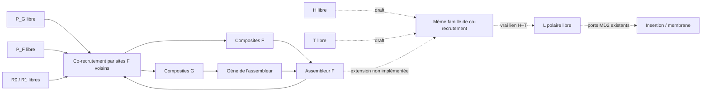

# Fabrication de L — draft matériel et alternatives, lot32

Ce texte ferme une partie du raisonnement qualitatif, pas une nouvelle chimie
validée. Aucun outil EL, gène ou règle n'est ajouté. Le candidat simulé reste
P/R+L préparé ; C0B/XYZ et ses trois synthétases restent une spécification
conditionnelle distincte. Ne pas remplacer silencieusement son réseau par ce draft.

## Partir des vrais constituants du candidat actuel

Un L est déjà un composite de deux billes H/T. Son lien axial a une longueur
0,65 ; les ports latéraux tête/queue du candidat MD2 organisent la courbure.
La valeur short_length concerne la géométrie latérale, pas le lien H–T.
Ces billes sont actuellement liées dès l'initialisation : L n'est pas fabriqué.
Un P/R a un lien axial0,45, et les supports P_G/P_F donnent deux familles
utilisables par la copie/expression. Le motif catalytique F01 rapproche P et R,
puis favorise leur lien et libère le produit. Son efficacité minimale est l'objet
de MIN1, pas déjà celle d'une synthétase L.

Une voie économique est d'étendre **le même co-recrutement** aux H et T libres :

Ici les six types matériels P_G/P_F/R0/R1/H/T sont conservés. H/T sont des
intrants alimentaires déclarés, pas des L préfabriqués ni une nouvelle enzyme.
Cela simplifie la constructibilité du candidat P/R+L ; cela **ne démontre pas**
le cahier des charges plus compact XYZ/C0B ou un alphabet minimal universel.

## Cycle local proposé pour la voie polyvalente

1. Un site F0 capte un donneur libre P_G/P_F/H ; un site F1 capte un accepteur
   libre R0/R1/T. Saturation et liaisons réversibles réutiliseraient le mécanisme
   actuel, avec ses vrais ligands, pas une opération sur une protéine entière.
2. Deux sites F directement liés tiennent deux billes. Leur proximité physique
   et une table élémentaire de compatibilité autorisent P_G–R, P_F–R ou H–T.
   P–T/H–R sont incompatibles ; aucun nom EN/EA/EL ne décide le produit.
3. Les ports axiaux saturés définissent le produit et empêchent sa recapture.
   Le vrai T peut se lier à n'importe quel H admissible : aucun partenaire
   préassigné n+i et aucune création de deux billes « L » par remplacement.
4. Un lien H–T expose les propriétés polaires et les ports latéraux locaux de
   ce composite. Ses forces sont celles du L actuel ; sa géométrie se détend
   vers0,65. Il peut ensuite s'associer à d'autres L et à une frontière existante.
5. L'occupation locale libère les deux sites F, qui recommencent. Les produits
   G/F alimentent respectivement copie et expression de l'assembleur lui-même.

Motif réactif borné à six billes comme aujourd'hui, mais **extension de loi**
non testée : captures H/T, compatibilité et activation des forces de L ne sont
pas gratuites. La pose à rayon0,58 pourrait aussi mal convenir à H–T : tester
la relaxation sans changer le rayon par enzyme pour sauver une scène.

Coût présumé à chiffrer avant implementation : zéro nouveau type matériel et
zéro nouvel outil/gène pour cette voie, occupation d'un port H/T, table de cinq
paires compatibles et deux longueurs axiales0,45/0,65 déjà existantes. Les
paramètres de capture/bonus seraient communs, sans nouveau taux spécialisé L.
Le passage libre/lié change des potentiels et doit rester déclaré comme aide
énergétique non calibrée. Aucun travail dirigé gratuit ni carrier E/W supposé
implémenté. La perte/reconstruction de L et l'énergie Q-01/Q-02 restent à fermer.

## Le contre-exemple à tester avant de construire une cellule

Le co-recruteur large peut gaspiller son temps à capturer les mauvais couples.
Trois classes donneuses ×trois classes acceptrices donnent neuf couples de
types, dont cinq compatibles. C'est un décompte, pas une probabilité de réaction.
Les mauvaises captures peuvent séquestrer le dernier outil, H/T s'adsorber sur
la membrane ou un nouveau L rester collé à F. Un produit polaire « déclaré »
ne compte pas s'il ne fonctionne pas avec les ports MD2 existants.

Plus petit protocole futur, après choix explicite du candidat :

- H/T dispersés et un assemblage F déjà étudié, sans L initial ; témoins sans
  outil, sites déliés et bonus ablaté. Vrais partenaires échangés et bilan atomique.
- Produits G/F/L dans le même bain, mêmes lois/taux et température ; quantifier
  chaque débit utile, mauvais couples, temps de site bloqué et libération répétée.
- Transférer les H–T **réellement fabriqués** à l'association/insertion MD2,
  sans conversion d'IDs, de type d'agrégat ou de géométrie par un observateur.
- Exprimer le même outil puis retrouver les trois flux. Tenir séparés outil
  préparé, nouvelle expression, réemploi des produits et maintien sous pertes.

Obstacle logiciel identifié, pas à cacher en raccourci scientifique : la
membrane actuelle suppose n têtes et les queues n+i. Des partenaires H/T
variables demandent une table de liens physiques et l'adaptation des noyaux,
ou une vue indexée qui redistribue exactement positions/forces aux vrais IDs.
La vue peut indexer des liens locaux ; elle ne peut chercher une vésicule ou
inventer des partenaires. Aucun second moteur/scheduler n'est nécessaire.
Tester cohérence tree/brute, forces réciproques, reprise et produits libres.

## Alternatives si le même outil ne suffit pas

Une pince distincte avec affinité locale H/T pourrait réduire les captures
parasites, au prix d'un gène et de son renouvellement. Une préférence portée
par des sites/potentiels réutilisables serait admissible ; une bille « EL »
qui fabrique L par son identité ne le serait pas. Cette nouvelle machine
demande la proposition et l'accord utilisateur prévus dans DESIGN_PRINCIPLES.
Elle n'est ni implémentée ni implicitement autorisée ici.

Autre alternative : produits isomasses depuis XYZ avec ports/liaisons distincts
N/A/L. Plus petit alphabet alimentaire potentiel, mais nouvelle représentation
et sélectivité à établir. Ne pas additionner ses succès hypothétiques à MIN1.

Décision : MIN1 mesure d'abord le coût minimal de l'assembleur existant et son
renouvellement sous MD2. Le draft donne un mécanisme local falsifiable pour L
et nomme ses coûts/obstacles ; il n'ajoute pas un succès ni ne garantit sa
compatibilité. Si la pince polyvalente échoue, comparer ces alternatives plutôt
que prolonger indéfiniment le réglage de la génétique.
