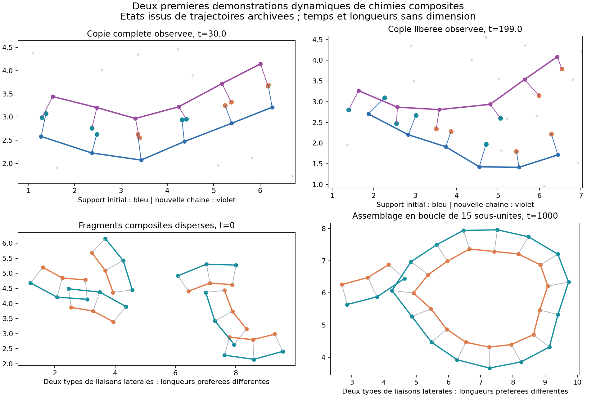
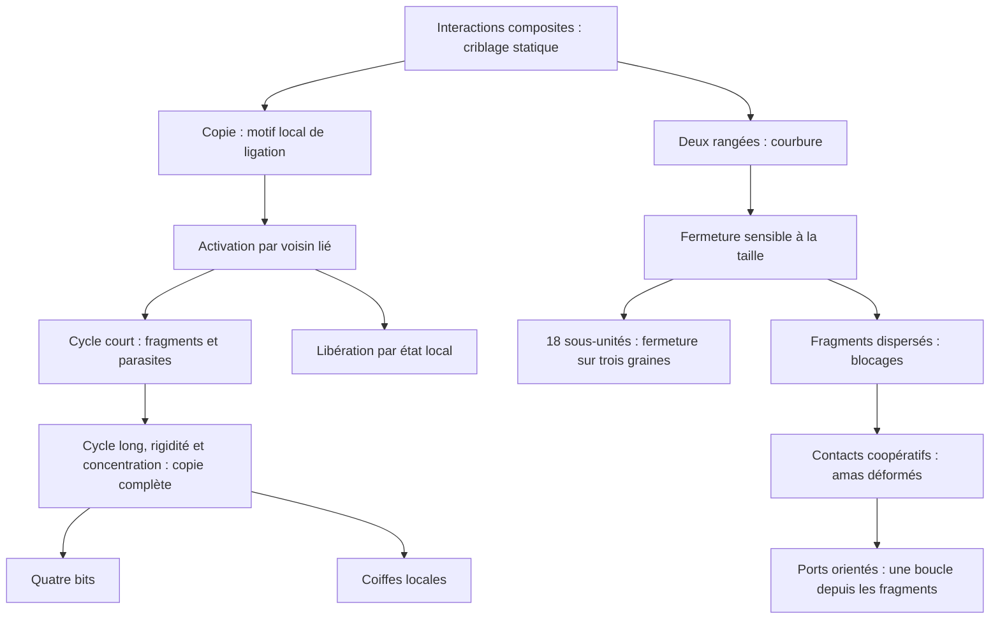

# Copie et membranes : premiers démonstrateurs dynamiques

> **Document historique du lot 1.** L'état actuel figure dans
> [MATURITY.md](MATURITY.md) et [BATCH_02.md](BATCH_02.md). Le lot 2 ajoute une
> deuxième génération dans un essai, l'expression G→F et des contrôles du bain
> mixte ; les limites ci-dessous décrivent les preuves disponibles au lot 1.

Le projet possède maintenant un skill de méthode de recherche, un arbre de
pistes et des expériences reproductibles. Les billes sont mobiles et leurs
assemblages déformables. La simulation peut utiliser superposition sélective,
liaisons saturables et activité modifiée par l'occupation d'un voisin lié.

## Ce qui fonctionne dans les conditions testées

**Copie binaire.** Un polymère préparé de sous-unités composites B-Q recrute des
monomères libres. Une règle symétrique complète des motifs locaux de liaisons.
La chaîne 001011 a produit une nouvelle chaîne complète puis libérée dans les
trois graines testées. Une autre séquence, 010010, est également copiée avec les
mêmes règles. La comparaison se fait à inversion près, car les chaînes ne sont
pas polarisées.

Le cycle de libération est externe et fixé à l'avance. Il ne dépend pas du
succès d'une copie. Sans ce cycle, le contrôle testé produit une copie complète
qui reste attachée. Sans polymère initial, le contrôle testé ne produit aucune
ligation. Deux des trois graines ont aussi une ligation soutenue par une copie
complète ; ce n'est pas encore une seconde génération complète.

**Courbure et fermeture.** Un ruban droit préparé de 18 sous-unités à deux billes
se courbe puis ferme ses deux rangées dans les trois graines testées. Le moteur
ne cherche pas de boucle : la courbure vient des longueurs préférées différentes
des deux rangées, puis les ports libres proches se lient. Le contrôle à rangées
de même longueur reste presque droit dans la fenêtre testée.

**Assemblage de fragments.** La branche à ports orientés V6 assemble aussi cinq
fragments dispersés de trois sous-unités en une boucle de 15. Cette réussite
concerne une des deux graines essayées ; l'autre reste bloquée. Un essai partant
de sous-unités entièrement libres échoue également. La possibilité est donc
observée, mais sa robustesse reste à obtenir.



Ces essais établissent deux points de fonctionnement, avec leurs helpers. Ils
ne donnent pas encore de taux de réussite général, de fidélité sous mutation,
de régime de croissance génétique autonome, ni de cellule intégrée.

## Arbre et traces



L'[arbre structuré](branches.json) donne parents, hypothèses, statuts et
conclusions. Le [journal](LOG.md) explique les bifurcations. Le
[registre de toutes les exécutions](RESULTS.md) inclut les résultats négatifs et
les incidents techniques. Les [modèles](MODEL.md) détaillent les lois et helpers
réellement utilisés. La méthode réutilisable est dans le
[skill du projet](../.agents/skills/local-chemistry-research/SKILL.md).

La [revue de l'ancien projet](LEGACY_PROJECT_NOTES.md) conserve ses lois locales,
astuces et architecture, avec une archive ciblée des sources indépendante du
dossier temporaire. Les nouvelles pistes T7/T8/V7/M0/W0 sont proposées, pas testées.

## Ce qui reste décisif

La fermeture depuis un ruban prépolymérisé fonctionne ; l'assemblage depuis des
fragments dispersés a une réussite fragile et celui depuis des sous-unités libres
reste à obtenir. Les premiers essais se piègent en amas. La branche V6 remplace
l'attraction isotrope des extrémités par des petits ports orientés définis par
deux billes voisines, avec forces et couples vérifiés par différences finies.
L'ajout de réversibilité aux interfaces mal assemblées est un prochain test utile.

Une boucle de ruban n'est pas encore un compartiment fonctionnel : la rétention
de contenu et la perméabilité ne sont pas vérifiées. Le couplage matériel entre
les copies, la fabrication des sous-unités, les catalyseurs et la membrane reste
également ouvert. Les deux démonstrateurs utilisent le même noyau mécanique,
mais leur chimie commune complète n'est pas encore établie.

## Refaire un essai

Depuis la racine du projet, avec NumPy et Matplotlib installés :

```powershell
python experiments/run_local_research.py T4 --duration 600 --seed 0
python experiments/run_local_research.py V4 --duration 300 --seed 0
python experiments/test_local_mechanics.py
```

Pour rejouer les sources exactes d'un dossier archivé et comparer toutes ses
métriques, sans modifier les preuves :

```powershell
python experiments/replay_local_run.py research/runs/T2_s0_20261023T113603113517Z
```

Ce rejeu a reproduit exactement les métriques de cet ancien essai, malgré les
modifications ultérieures du moteur. Chaque nouvelle exécution a son dossier
distinct, avec configuration, graines, sources, SHA-256, trajectoire et résultats.
